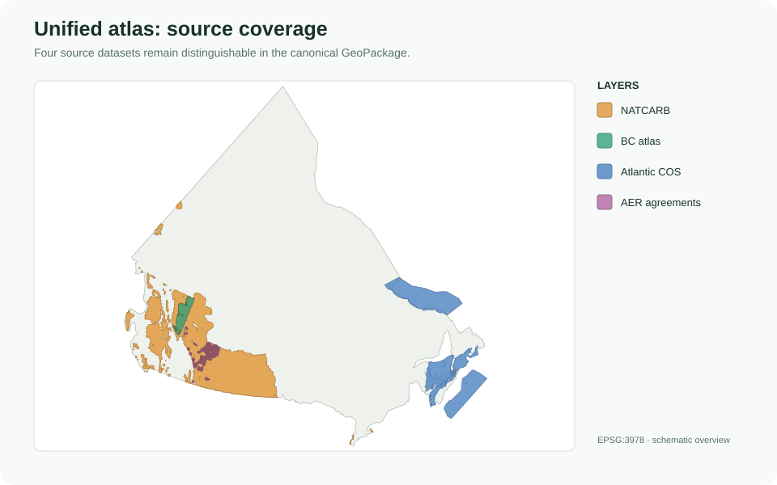

# Canadian CO₂ Geological Storage Data

`canco2-storage` builds a source-faithful, queryable Canadian geological CO₂
storage atlas from public government datasets. It preserves provenance,
uncertainty, source identifiers, and the distinction between geological
capacity, geological prospectivity, and regulatory tenure.



The project produces independent Silver GeoPackages for each source and one
canonical unified GeoPackage. It does **not** turn every mapped polygon into a
capacity estimate: logical storage units, spatial representations, assessments,
and administrative features remain separate.

## Start here

| If you want to… | Read or run |
| --- | --- |
| Understand what is in the unified file | [Data catalog and maps](docs/data-catalog.md) |
| Query it safely with Python or SQL | [Query guide](docs/quickstart.md) |
| Understand fields and table grain | [Schema contract](docs/schema.md) |
| Rebuild the data products | [Workflow](docs/workflow.md) |
| Run a working read-only example | `python examples/unified_quickstart.py` |

The built artifact is under `data/processed/unified_storage/`. To locate the
newest version programmatically:

```python
from pathlib import Path

package = sorted(
    Path("data/processed/unified_storage").glob(
        "*_13_CanadaGeologicalStorageUnified_AV_v2.gpkg"
    )
)[-1]
```

Open that file directly in QGIS or ArcGIS Pro, or read it with GeoPandas:

```python
import geopandas as gpd

units = gpd.read_file(package, layer="storage_units", ignore_geometry=True)
features = gpd.read_file(package, layer="storage_features")
assessments = gpd.read_file(
    package, layer="storage_assessments", ignore_geometry=True
)
tenure = gpd.read_file(package, layer="administrative_features")
```

All unified spatial layers use **EPSG:3978 — NAD83 / Canada Atlas Lambert**.

## Unified data model

| Table | Grain | Use it for |
| --- | --- | --- |
| `storage_units` | One logical geological storage unit | Identity and classification |
| `storage_features` | One spatial representation of a unit | Mapping and spatial selection |
| `storage_assessments` | One quantitative or qualitative assessment | Capacity and prospectivity values |
| `administrative_features` | One regulatory or tenure feature | AER agreement and tract mapping |

```text
storage_units (1) ───────< storage_features (many)
      │                            │
      └──────< storage_assessments >──── feature- or unit-scoped

administrative_features             separate regulatory/tenure hierarchy
```

The important query rule is to inspect `assessment_scope` before joining.
Feature-scoped assessments join on `storage_feature_id`; unit-scoped
assessments join on `storage_unit_id`. Joining a unit-scoped capacity value to
every feature and then summing it duplicates capacity for multipart units.

## Included source datasets

| Unified source | What it represents | Decomposition in the unified file |
| --- | --- | --- |
| DOE/NETL NATCARB All Data v1502 | Regional screening storage resources | Saline grid cells, coal grid cells, oil/gas polygons |
| Northeast BC Storage Atlas | Quantitative pool and aquifer screening | Pool features and aquifer features; assessments at logical-unit grain |
| GSC Open File 8996 | Qualitative Chance of Success | 15 Atlantic storage units in two geological groups |
| AER Carbon Sequestration Agreements | Regulatory/tenure evidence | Agreement polygons and retained source tracts |

See the [data catalog](docs/data-catalog.md) for maps, current feature counts,
layer names, and interpretation notes for every source.

## Interpretation guardrails

- `geological_storage_capacity` is a source-reported screening resource, not
  demonstrated injectivity or project-ready capacity.
- `geological_prospectivity` is geological evidence or ranking information,
  not tonnes of storage.
- `regulatory_tenure` is rights or agreement information, not geological
  suitability.
- Null capacity means no estimate was supplied; it does not mean zero.
- NATCARB grid cells and polygons are different representations. Do not add
  them together or ignore provider duplicate/overlap flags.
- Source IDs are valid within their documented source and layer. Geographic
  overlap does not establish a cross-source geological identity.

## Install and build

Python 3.12 or newer is required.

```bash
python -m pip install -e .
python -m pip install -e ".[test]"
```

Build Bronze inputs, the four Silver packages, and the unified atlas:

```bash
canco2-build
```

Equivalent repository script:

```bash
python scripts/build_all.py
```

Useful stage-specific commands:

```bash
canco2-run-bronze
canco2-run-silver
canco2-build-geopackages
canco2-build-unified
```

Select precursor datasets with `--datasets`; use `--skip-bronze` or
`--skip-silver` when the corresponding stage is already complete. The unified
build still requires all four precursor Silver GeoPackages.

Regenerate the documentation maps after building the unified atlas:

```bash
python scripts/generate_documentation_maps.py
```

## Repository layout

```text
canco2-storage/
├── data/
│   ├── raw/                  # retained Bronze inputs
│   └── processed/            # source Silver packages and unified atlas
├── docs/                     # query guide, catalog, schema, workflow
├── examples/                 # executable read-only examples
├── notebooks/                # exploratory source analysis
├── scripts/                  # workflow and documentation entry points
├── src/canco2_storage/
│   ├── acquisition/          # download and Bronze validation
│   ├── harmonize/            # source transformations and unified schema
│   ├── metadata/             # metadata and generated package READMEs
│   └── orchestration/        # registered build stages
└── tests/
```

## Project status

The package is at the `0.2.0a1` core-alpha milestone. The complete
Bronze-to-Silver-to-unified workflow is implemented and includes persisted
metadata, QA, source lineage, sidecar field dictionaries, and generated
artifact documentation. The products are suitable for research screening and
review; they are not a claim of demonstrated injectivity or project-ready
storage capacity.

## Sources

- [GSC Open File 8996](https://publications.gc.ca/site/eng/9.927009/publication.html), DOI `10.4095/332145`
- [Geoscience BC Northeast BC Atlas](https://www.geosciencebc.com/projects/2022-001/)
- [AER Carbon Sequestration Agreements](https://gis.energy.gov.ab.ca/Geoview/CarbonSequestration)
- [DOE/NETL NATCARB All Data v1502](https://edx.netl.doe.gov/dataset/natcarb-alldata-v1502)
