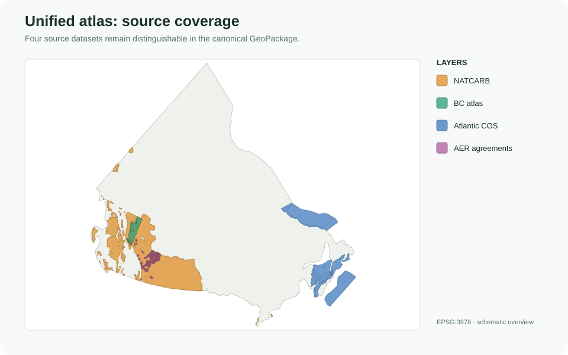
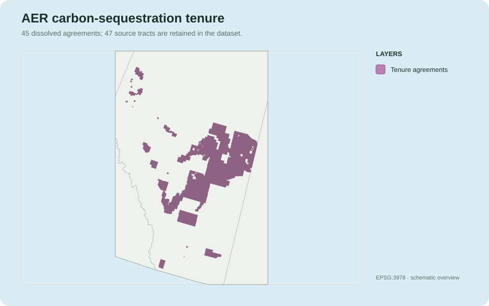
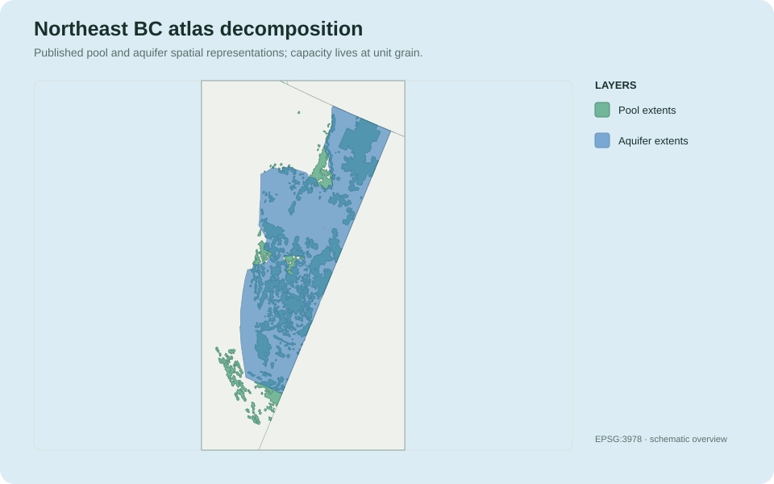
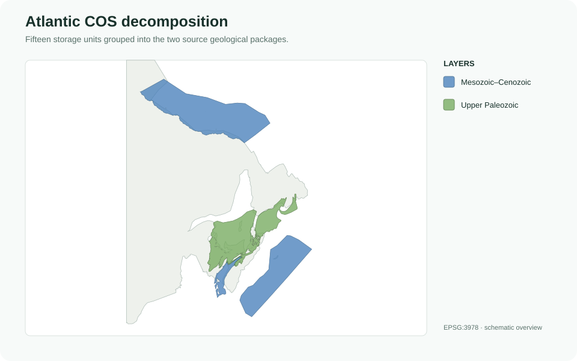
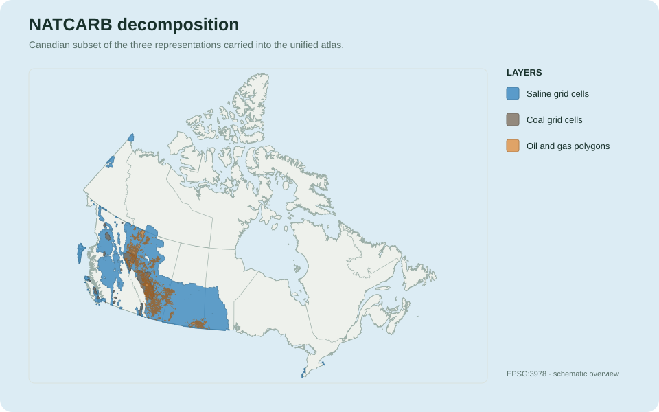

# CANCO2-Storage Data Catalog

This catalog explains how the source files, four daughter GeoPackages, and
unified Canadian atlas relate to one another. It is intended to answer three
questions before a student opens the data in Python, ArcGIS Pro, or QGIS:

1. Which source product does a feature come from?
2. How was that source represented in its daughter GeoPackage and in the
   unified atlas?
3. Which fields, layers, and identifiers should be used to select or join it?

Counts below describe the reproducible build completed on **November 11,
2026**. Output filenames contain the build date, and counts may change if a
provider revises a source or the harmonization rules change.

All documentation maps use the Statistics Canada 2021 province and territory
digital boundary as geographic context. Source and output geometries are shown
in **EPSG:3978 — NAD83 / Canada Atlas Lambert**. The maps are simplified
overviews; the GeoPackages remain the analysis-ready artifacts.

## Data lineage at a glance

```text
Provider archive
    ↓
Raw source file, shapefile, workbook, or File Geodatabase feature class
    ↓
Daughter GeoPackage (source-specific Silver representation)
    ↓
Unified GeoPackage (canonical cross-source representation)
    ↓
Filter, join, map, or export for analysis
```

The daughter packages preserve source-specific detail. The unified atlas keeps
the fields and geometry needed for consistent cross-source analysis, but it is
not a replacement for every source-native field or supporting layer.

## Unified Canadian atlas

**Artifact:** `20261111_13_CanadaGeologicalStorageUnified_AV_v2.gpkg`



The unified atlas combines three geological-storage sources and one
administrative-tenure source. The geological sources use the canonical
`storage_*` tables. AER agreements are deliberately isolated in
`administrative_features` because a tenure polygon is not evidence of a
geological storage unit or capacity estimate.

| Canonical table | Records | Spatial? | Record grain | Primary identifier |
| --- | ---: | --- | --- | --- |
| `storage_units` | 2,843 | No | One logical geological storage unit | `storage_unit_id` |
| `storage_features` | 35,320 | Yes | One mapped representation of a unit | `storage_feature_id` |
| `storage_assessments` | 35,245 | No | One estimate or score at unit or feature scope | `storage_assessment_id` |
| `administrative_features` | 92 | Yes | One agreement or retained source tract | `administrative_feature_id` |

### Daughter-to-unified mapping

| Daughter package | Scientific role | Daughter spatial layers | Unified destination | Unified `source_dataset` |
| --- | --- | --- | --- | --- |
| AER Carbon Sequestration Agreements | Regulatory or pore-space tenure | `aer_agreements`, `aer_agreement_tracts` | `administrative_features` | `AER Carbon Sequestration Agreements` |
| Northeast BC Storage Atlas | Quantitative pool and aquifer screening | `pool_features`, `aquifer_features` | `storage_units`, `storage_features`, `storage_assessments` | `BC_STORAGE_ATLAS` |
| GSC Atlantic Open File 8996 | Qualitative Chance of Success mapping | `storage_units` | `storage_units`, `storage_features`, `storage_assessments` | `ATLANTIC_COS` |
| DOE/NETL NATCARB v1502 | Regional capacity/resource screening | Five spatial resource layers | `storage_units`, `storage_features`, `storage_assessments` | `NATCARB` |

### The first filters to learn

Use `source_dataset` to select a daughter source and `source_layer` to select a
representation within that source. Then respect the table grain:

```text
Need a map or spatial filter?
├── Geological storage/prospectivity → storage_features
└── Agreement or tenure boundary    → administrative_features

Need an estimate or score?
└── storage_assessments
    ├── assessment_scope = feature → join on storage_feature_id
    └── assessment_scope = unit    → join on storage_unit_id

Need identity or classification?
└── storage_units
```

Do not sum a unit-scoped assessment once per mapped feature. One logical unit
can have several spatial features.

### ArcGIS Pro filtering and joining matrix

Add the unified GeoPackage to the ArcGIS Pro Catalog pane, then add
`storage_features`, `administrative_features`, `storage_units`, and
`storage_assessments` to the map. The two spatial layers appear in the map;
the other two appear under **Standalone Tables**.

For each intended map, make a copy of the applicable spatial layer and set its
filter under **Layer Properties → Definition Query**. Then use
**Joins and Relates → Add Join** only where the matrix specifies one.

| ArcGIS map view | Starting layer and definition query | Assessment join | Identity join | Critical interpretation rule |
| --- | --- | --- | --- | --- |
| NATCARB saline | `storage_features`: `source_dataset = 'NATCARB' AND source_layer = 'saline_resource_cells'` | Join `storage_assessments` on `storage_feature_id` | Join `storage_units` on `storage_unit_id` | Feature-scoped capacity; consult the daughter assessed, overlap, and duplicate flags before summing |
| NATCARB coal | `storage_features`: `source_dataset = 'NATCARB' AND source_layer = 'coal_resource_cells'` | Join `storage_assessments` on `storage_feature_id` | Join `storage_units` on `storage_unit_id` | Feature-scoped capacity; do not combine with the daughter area representation |
| NATCARB oil/gas | `storage_features`: `source_dataset = 'NATCARB' AND source_layer = 'oil_gas_resources'` | Join `storage_assessments` on `storage_feature_id` | Join `storage_units` on `storage_unit_id` | Feature-scoped resource estimates are screening values, not permitted capacity |
| BC pools or aquifers | `storage_features`: `source_dataset = 'BC_STORAGE_ATLAS' AND source_layer = 'pool_features'` or `source_layer = 'aquifer_features'` | Join `storage_assessments` on `storage_unit_id` | Join `storage_units` on `storage_unit_id` | Unit-scoped values can repeat across multiple mapped features; never sum the repeated joined value |
| Atlantic COS | `storage_features`: `source_dataset = 'ATLANTIC_COS' AND source_layer = 'storage_units'` | Join `storage_assessments` on `storage_feature_id` | Join `storage_units` on `storage_unit_id` | COS is feature-scoped prospectivity, not tonnes of storage |
| AER agreements | `administrative_features`: `source_dataset = 'AER Carbon Sequestration Agreements' AND source_layer = 'aer_agreements'` | None | None | One row per agreement; use this representation for agreement counts and agreement-level area |
| AER source tracts | `administrative_features`: `source_dataset = 'AER Carbon Sequestration Agreements' AND source_layer = 'aer_agreement_tracts'` | None | None | Tracts are children of agreements; do not count agreements and tracts together |

For an assessment join, use the matrix field as both the **Input Join Field**
and the **Join Table Field**. For an identity join, use `storage_unit_id` on
both sides. The identifiers are stable and globally unique within the unified
artifact.

Joins are temporary map-layer properties. To create a separate derived file,
right-click the filtered and joined layer and use **Data → Export Features**.
Do not overwrite the authoritative unified GeoPackage, and record the source
filename, definition query, and join fields with the exported result.

## Daughter 1: AER Carbon Sequestration Agreements

See the [detailed AER agreements guide](datasets/aer-agreements.md) for the
agreement/tract hierarchy, administrative categories, area fields, legal
interpretation limits, maps, and unified parent-child linkage.

### What the source contains

The Bronze source contains one ESRI Shapefile dataset:

| Raw source file | Role | Daughter representation | Unified representation |
| --- | --- | --- | --- |
| `CS_Agreements.shp` | Published source tracts for Alberta carbon-sequestration agreements | `aer_agreement_tracts` and dissolved `aer_agreements` | `administrative_features` with `source_layer = 'aer_agreement_tracts'` or `'aer_agreements'` |

The `.shp` geometry is accompanied by the required `.dbf`, `.shx`, and `.prj`
files. Together they form one shapefile dataset; the `.shp` file should not be
copied or interpreted alone.

### Daughter GeoPackage

**Artifact:** `20261111_13_AERCarbonSequestrationAgreements_AV.gpkg`



| Daughter layer/table | Records | Spatial? | Meaning |
| --- | ---: | --- | --- |
| `aer_agreement_tracts` | 47 | Yes | Source tracts retained at their published grain |
| `aer_agreements` | 45 | Yes | Tracts dissolved to one feature per `agreement_id` |
| `metadata_aer_agreements` | 25 | No | Dataset provenance and interpretation metadata |
| `qa_aer_agreements` | 21 | No | Validation and geometry QA results |

### How to query it

- Use `agreement_id` to select or group an agreement.
- Use `tract_id` to identify a source tract.
- In the unified atlas,
  `parent_administrative_feature_id` links each tract to its dissolved
  agreement feature.
- Use `source_layer` to distinguish the agreement and tract representations.
- Do not interpret these polygons as storage capacity, injectivity, or a
  subsurface storage assessment.

## Daughter 2: Northeast BC Storage Atlas

See the [detailed Northeast BC guide](datasets/bc-storage-atlas.md) for the
Appendix C assessments, Appendix E shapefile families, formation hierarchy,
capacity grain, source anomalies, and query guidance.

### What the source contains

The source has two complementary components:

- **Appendix C workbooks** provide the logical pool and aquifer records and
  their reported capacity values.
- **Appendix E shapefiles** provide published spatial representations and
  supporting geological map layers.

Appendix E contains 109 shapefiles. Twenty-six directly create canonical
storage geometry: one pool master and 25 aquifer-storage shapefiles. The other
83 remain valuable contextual source layers but are not promoted to
`storage_features`.

| Raw shapefile category | Files | Canonical storage geometry? | Treatment |
| --- | ---: | --- | --- |
| Pool master | 1 | Yes | Builds `pool_features` |
| Aquifer storage | 25 | Yes | Builds `aquifer_features` |
| Pool candidate | 14 | No | Supporting published map layer |
| Pool non-candidate | 14 | No | Supporting published map layer |
| Pool commingled support | 4 | No | Supporting published map layer |
| Pool net-reservoir support | 12 | No | Supporting published map layer |
| Pool contour support | 1 | No | Supporting published map layer |
| Net-reservoir support | 9 | No | Supporting published map layer |
| Structure support | 9 | No | Supporting published map layer |
| Pressure support | 7 | No | Supporting published map layer |
| Temperature support | 4 | No | Supporting published map layer |
| Depth support | 6 | No | Supporting published map layer |
| Emissions reference | 1 | No | Contextual reference layer |
| Other support | 2 | No | Contextual source layer |

### Shapefiles used for canonical storage geometry

The pool geometry comes from:

`BCOGC_POOLS_CO2_STORAGE_CDL_83UTM10_PG.shp`

The 25 aquifer source files are grouped below by geological unit. Filenames are
reported exactly as published, including source naming inconsistencies.

| Geological unit | Canonical aquifer shapefiles |
| --- | --- |
| Peace River | `GBCS_PEACE_RIVER_AQUIFER_DAWSON_83UTM10_PG.shp` |
| Bluesky | `GBCS_BLUESKY_AQUIFER_CO2_STORAGE_CHINCHAGA_DAHL_83UTM10_PG.shp`<br>`GBCS_BLUESKY_AQUIFER_CO2_STORAGE_DOE_AIRPORT_83UTM10_PG.shp` |
| Cadomin | `GBCS_CADOMIN_AQUIFER_PARKLAND_MUSKRAT_83UTM10_PG.shp`<br>`GBCS_CADOMIN_AQUIFER_STODDART_WEST_83UTM10_PG.shp`<br>`GBCS_CADOMIN_AQUIFER_SUNRISE_DOE_83UTM10_PG.shp` |
| Nikanassin | `GBCS_NIKANASSIN_AQUIFER_BEG_SIPHON_83UTM10_PG.shp`<br>`GBCS_NIKANASSIN_AQUIFER_BLUEBERRY_TWO_RIVERS_83UTM10_PG.shp`<br>`GBCS_NIKANASSIN_AQUIFER_BRASSEY_CUTBANK_83UTM10_PG.shp` |
| Baldonnel | `GBCS_BALDONNEL_AQUIFER_BOUNDARY_LAKE_OSPREY_83UTM10_PG.shp`<br>`GBCS_BALDONNEL_AQUIFER_DAWSON_83UTM10_PG.shp`<br>`GBCS_BALDONNEL_AQUIFER_MONIAS_BEG_83UTM10_PG.shp`<br>`GBCS_BALDONNEL_AQUIFER_PARKLAND_STODDART_83UTM10_PG.shp` |
| Halfway | `GBCS_HALFWAY_AQUIFER_FLATROCK_MONIAS_83UTM10_PG.shp`<br>`GBCS_HALFWAY_AQUIFER_PEEJAY_WEASEL_83UTM10_PG.shp`<br>`GBCS_HALFWAY_AQUIFER_WEST_FIREWEED_83UTM10_PG.shp` |
| Belloy | `GBCS_BELLOY_AQUIFER_BOUNDARY_LAKE_83UTM10_PG.shp`<br>`GBCS_BELLOY_AQUIFER_DOE_STODDART_83UTM10_PG.shp`<br>`GBCS_BELLOY_AQUIFER_LADYFERN_RING_83UTM10_PG.shp` |
| Debolt | `GBCS_DEBOLT_AQUIFER_NORTH_OSBORN_RING_83UTM83_PG.shp`<br>`GBCS_DEBOLT_AQUIFER_WEST_BLUEBERRY_83UTM83_PG.shp` |
| Slave Point | `GBCS_SLVPT_AQUIFER_NORTH_10UTM83_PG.shp`<br>`GBCS_SLVPT_AQUIFER_CENTRAL_10UTM83_PG.shp`<br>`GBCS_SLVPT_AQUIFER_SOUTH_10UTM83_PG.shp`<br>`GBCS_SLVPT_AQUIFER_SOUTH_MUSKEG_10UTM83_PG.shp` |

### Daughter GeoPackage

**Artifact:** `20261111_13_BCStorageAtlas_AV.gpkg`



| Daughter layer/table | Records | Spatial? | Meaning |
| --- | ---: | --- | --- |
| `pool_units` | 1,238 | No | Logical pool assessments derived from Appendix C |
| `pool_features` | 1,309 | Yes | Pool geometries linked to logical units |
| `aquifer_units` | 25 | No | Logical aquifer assessments derived from Appendix C |
| `aquifer_features` | 29 | Yes | Features read from the 25 canonical aquifer shapefiles |
| `metadata_gbc_ne_atlas` | 27 | No | Dataset provenance and interpretation metadata |
| `qa_gbc_ne_atlas` | 21 | No | Cross-source reconciliation and geometry QA |

### Unified representation and querying

| Daughter table | Unified table | Unified `source_layer` | Join/filter guidance |
| --- | --- | --- | --- |
| `pool_units` | `storage_units`, `storage_assessments` | `pool_units` in assessments | Join with `storage_unit_id`; assessment scope is `unit` |
| `pool_features` | `storage_features` | `pool_features` | Map/filter geometry with `storage_feature_id` |
| `aquifer_units` | `storage_units`, `storage_assessments` | `aquifer_units` in assessments | Join with `storage_unit_id`; assessment scope is `unit` |
| `aquifer_features` | `storage_features` | `aquifer_features` | Map/filter geometry with `storage_feature_id` |

Do not multiply a pool or aquifer capacity by the number of mapped features.
Capacity belongs to the logical unit, not to each polygon representation.

## Daughter 3: GSC Atlantic Open File 8996

See the [detailed GSC Atlantic guide](datasets/gsc-atlantic.md) for all 15
source shapefiles, assessment areas, COS-component coverage, maps, lineage,
and query guidance.

### What the source contains

The source contains 15 shapefiles grouped into two geological packages. Every
source shapefile contributes to the daughter GeoPackage.

| Geological group | Raw shapefile | Daughter features |
| --- | --- | ---: |
| Mesozoic–Cenozoic | `ALBIAN_LOGAN_CANYON_TOTAL.shp` | 17 |
| Mesozoic–Cenozoic | `BARREMIAN_UPPER_MISSISAUGA_TOTAL.shp` | 10 |
| Mesozoic–Cenozoic | `BERRIASIAN_LOWER_MISSISAUGA_TOTAL.shp` | 12 |
| Mesozoic–Cenozoic | `Bjarni.shp` | 407 |
| Mesozoic–Cenozoic | `Fundy.shp` | 43 |
| Mesozoic–Cenozoic | `Gudrid.shp` | 812 |
| Mesozoic–Cenozoic | `LATE_ALBIAN_CREE_TOTAL.shp` | 8 |
| Mesozoic–Cenozoic | `Leif.shp` | 472 |
| Mesozoic–Cenozoic | `UPPER_JURASSIC_MOHAWK_MIC_MAC_TOTAL.shp` | 17 |
| Mesozoic–Cenozoic | `VALANGINIAN_HAUTERIVIAN_MID_MISSISAUGA_TOTAL.shp` | 13 |
| Upper Paleozoic | `Cumberland_non_Magdalen.shp` | 150 |
| Upper Paleozoic | `Horton_non_Magdalen.shp` | 181 |
| Upper Paleozoic | `Magdalen_Cumberland.shp` | 712 |
| Upper Paleozoic | `Magdalen_Horton.shp` | 691 |
| Upper Paleozoic | `Pictou.shp` | 1,166 |

### Daughter GeoPackage

**Artifact:** `20261111_13_AtlanticStorageCOS_AV.gpkg`



| Daughter layer/table | Records | Spatial? | Meaning |
| --- | ---: | --- | --- |
| `storage_units` | 4,711 | Yes | Source polygons with standardized identity and COS fields |
| `metadata_gsc_atlantic` | 28 | No | Dataset provenance and interpretation metadata |
| `qa_gsc_atlantic` | 12 | No | Source, projection, and geometry QA |

### Unified representation and querying

The daughter spatial layer is separated into three canonical tables:

- 15 logical records in `storage_units`;
- 4,711 geometries in `storage_features`; and
- 4,711 feature-scoped records in `storage_assessments`.

All Atlantic features and assessments use `source_layer = 'storage_units'`.
Use `source_dataset = 'ATLANTIC_COS'` first, then select a geological unit with
`storage_unit_id`, `storage_name`, `formation`, or `geological_group`.

Reservoir, seal, trap, and total Chance of Success are qualitative
prospectivity measures. They are not storage capacity, injectivity, or tonnes
of CO2.

## Daughter 4: DOE/NETL NATCARB v1502

See the [detailed NATCARB guide](datasets/natcarb.md) for source feature
classes, estimate coverage, geological attributes, basin names, and query
guidance.

### What the source contains

NATCARB is not delivered as shapefiles. Its primary spatial source is the Esri
File Geodatabase `NATCARB_v1502.gdb`, accompanied by source metadata documents
and domain tables.

| Raw File Geodatabase feature class | Geometry | Daughter layer | Unified treatment |
| --- | --- | --- | --- |
| `NATCARB_Saline_10K_v1502` | Polygon grid cells | `saline_resource_cells` | Canadian subset carried into unified atlas |
| `NATCARB_Saline_Poly_v1502` | Resource-area polygons | `saline_resource_areas` | Retained in daughter only |
| `NATCARB_Coal_10K_v1502` | Polygon grid cells | `coal_resource_cells` | Canadian subset carried into unified atlas |
| `NATCARB_Coal_Poly_v1502` | Resource-area polygons | `coal_resource_areas` | Retained in daughter only |
| `NATCARB_OilGas_v1502` | Resource polygons | `oil_gas_resources` | Canadian subset carried into unified atlas |
| `NATCARB_Sources2011_v1502` | Points | — | Source/reference layer, not promoted |
| `NATCARB_Sources2012_v1502` | Points | — | Source/reference layer, not promoted |
| `NATCARB_Sources2013_v1502` | Points | — | Source/reference layer, not promoted |

Ten provider domain tables are normalized and retained in the daughter package
as `domain_*` tables. They document coded values such as assessed status,
overlap, duplication, fuel, partnership, and source type. They are not copied
into the unified atlas as standalone tables.

### Daughter GeoPackage

**Artifact:** `20261111_13_NATCARBStorage_AV.gpkg`



| Daughter layer/table | Records | Spatial? | Unified representation |
| --- | ---: | --- | --- |
| `saline_resource_cells` | 186,675 | Yes | 26,694 Canadian `saline_resource_cells` features |
| `saline_resource_areas` | 508 | Yes | Not carried into unified atlas |
| `coal_resource_cells` | 17,975 | Yes | 1,219 Canadian `coal_resource_cells` features |
| `coal_resource_areas` | 310 | Yes | Not carried into unified atlas |
| `oil_gas_resources` | 68,634 | Yes | 1,358 Canadian `oil_gas_resources` features |

The unified Canadian subset contains 1,565 logical units, 29,271 spatial
features, and 29,271 feature-scoped assessments.

### How to query it

- Start with `source_dataset = 'NATCARB'`.
- Select one representation with `source_layer`:
  `saline_resource_cells`, `coal_resource_cells`, or `oil_gas_resources`.
- Treat capacity as feature-scoped and join assessments with
  `storage_feature_id`.
- Inspect the daughter domain tables and source-native `ASSESSED`, `OVERLAP`,
  and `DUPLICATE` semantics before aggregation.
- Do not assume that overlapping polygons have been deduplicated.

## Documentation and lineage tables

The unified GeoPackage registers five non-spatial documentation tables in
`gpkg_contents`:

| Table | Purpose |
| --- | --- |
| `source_catalog_canada_geological_storage_unified` | Normalized source citation and identity |
| `source_metadata_canada_geological_storage_unified` | Complete precursor metadata lineage |
| `source_qa_canada_geological_storage_unified` | Complete precursor QA lineage |
| `metadata_canada_geological_storage_unified` | Unified artifact metadata and limitations |
| `qa_canada_geological_storage_unified` | Unified validation results |

The CSV files beside a GeoPackage are convenient sidecars. The registered
GeoPackage tables are the authoritative package contents.

Continue with the [beginner quickstart](quickstart.md) for setup and GIS use or
the [schema contract](schema.md) for stable field meanings.
