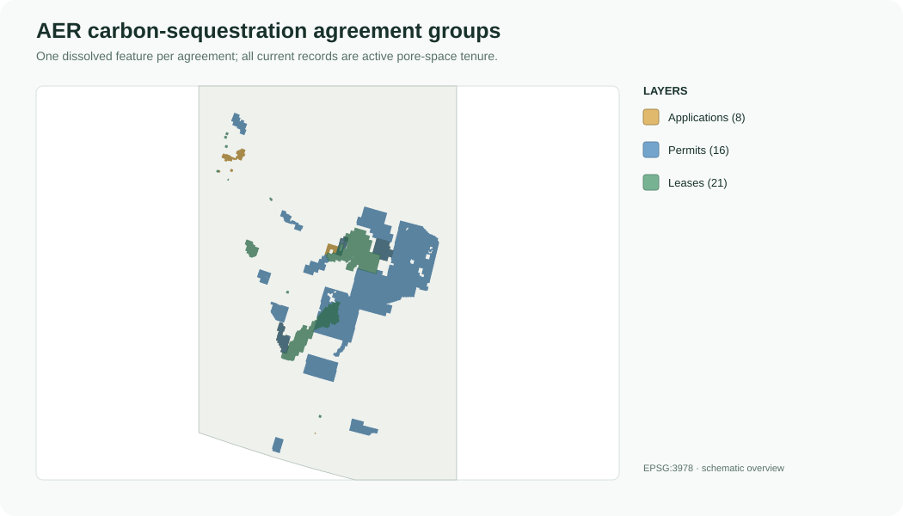
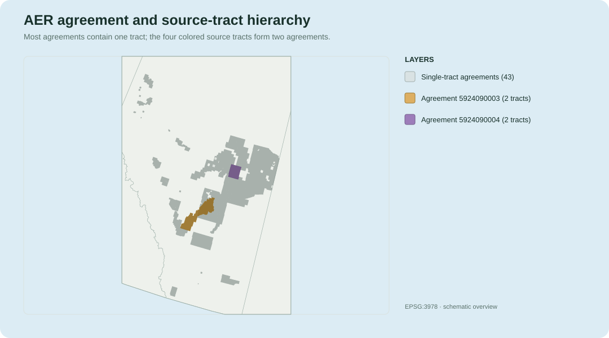

# AER Carbon Sequestration Agreements

This guide describes how the Alberta Energy Regulator (AER) Carbon
Sequestration Agreements shapefile is preserved as source tracts, dissolved to
agreement-level polygons, and represented in the unified Canadian atlas.

## At a glance

| Item | Value |
| --- | --- |
| Source organization | Alberta Energy Regulator |
| Source product | Carbon Sequestration Agreements |
| Web-map source attribution | Alberta Energy and Minerals |
| Geographic scope | Alberta, Canada |
| Published date | April 13, 2026 (web-map notice) |
| Data current as of | April 9, 2026 (web-map notice) |
| Update cadence | Daily for lease-status changes |
| Source access | [AER Carbon Sequestration map](https://gis.energy.gov.ab.ca/Geoview/CarbonSequestration) |
| Parent information | [Alberta carbon-sequestration tenure](https://www.alberta.ca/carbon-capture-utilization-and-storage-carbon-sequestration-tenure) |
| Licence | Open Government Licence – Alberta, as stated by the source notice |
| Primary source content | One shapefile; 47 agreement tracts in the reference build |
| Daughter output | <code>YYYYMMDD_13_AERCarbonSequestrationAgreements_AV.gpkg</code> |
| Daughter contents | <code>aer_agreement_tracts</code> and <code>aer_agreements</code> |
| Daughter CRS | EPSG:3978 — NAD83 / Canada Atlas Lambert |
| Unified source key | <code>source_dataset = 'AER Carbon Sequestration Agreements'</code> |
| Data class | <code>regulatory_tenure</code> |
| Assessment type | <code>carbon_sequestration_agreement</code> |
| Capacity / injectivity | No capacity data; injectivity not assessed |

These polygons represent administrative carbon-sequestration pore-space
agreements. They do not provide geological storage capacity, injectivity,
Chance of Success, permitted injection rate, or evidence that a project is
technically or commercially ready.

## Source currency and web-map attribution

The AER web map is a live publication surface, while the downloaded shapefile
and every generated GeoPackage are static snapshots. The mineral-information
site states that lease-status data are updated daily. Users who need the
current legal or administrative state should therefore consult the official
interactive map and download the latest source shapefile rather than relying
only on an older built artifact.

A web-map notice published on April 13, 2026 reported that its carbon
sequestration hubs and agreements were current as of April 9, 2026. That notice
documents the map's currency at that time; it is not assigned as the vintage
of a later downloaded source or local build. The dated GeoPackage filename and
its embedded metadata identify the local artifact snapshot.

The notice attributes the carbon-sequestration source information to Alberta
Energy and Minerals and the base-map data to the Government of Alberta under
the Alberta Open Government Licence. The broader mineral-information site also
credits separate providers for agreements, restrictions, mineral ownership,
base data, parks, wells, pipelines, and facilities. Those web-map credits
describe the interactive-site context; they do not mean that every contextual
web-map layer is included in this repository's AER agreement GeoPackage.

## Source and daughter hierarchy

The source can be understood as:

~~~text
CS_Agreements shapefile
└── source agreement tract
    ├── agreement_id
    ├── tract_id
    └── tract-specific zone description
        └── daughter aer_agreement_tracts
            └── dissolve by agreement_id
                └── daughter aer_agreements
~~~

The source shapefile contains 47 tract features belonging to 45 agreements.
Most agreements contain one tract. Two agreements contain two tracts each.
The daughter package therefore preserves both grains:

- <code>aer_agreement_tracts</code> is source-faithful and retains one row per
  published tract;
- <code>aer_agreements</code> is derived by dissolving the tracts so that each
  <code>agreement_id</code> has one feature.

Agreement-level attributes are checked for consistency before dissolve.
Distinct tract-level <code>zone_description</code> values are concatenated in
the agreement layer rather than discarded.

## Agreement groups

The current reference build contains:

| Agreement group | Agreements | Type codes |
| --- | ---: | --- |
| Application (<code>APP</code>) | 8 | <code>A58</code>, <code>A59</code>, <code>A61</code> |
| Permit (<code>PERMIT</code>) | 16 | <code>058</code> |
| Lease (<code>LEASE</code>) | 21 | <code>059</code>, <code>061</code> |

Agreement and type identifiers are preserved as text so leading zeroes and AER
coding are not lost. The broad <code>agreement_group</code> is appropriate for
general mapping; <code>agreement_type_code</code> retains the more specific
source classification.

All 45 records in the reference build have <code>mineral_type = 'PORE SPACE'</code>
and <code>status = 'ACTIVE'</code>. Those fields remain important because a
later AER release may contain additional values. Their present lack of
variation is why they are not mapped as separate figures.

## Agreement and tract decomposition

The grey features are the 43 single-tract agreements. For the two multi-tract
agreements, the figure displays the four source tracts directly:

| Agreement | Source tracts | Agreement group |
| --- | ---: | --- |
| <code>5924090003</code> | 2 | Lease |
| <code>5924090004</code> | 2 | Lease |

The agreement and tract layers describe the same tenure at different grains.
They must not be combined and counted as 92 independent agreements. Use the
agreement layer for one-feature-per-agreement analysis and the tract layer
when source tract identity or tract-specific zone information is required.

## Source attributes

Important standardized fields include:

| Field | Meaning |
| --- | --- |
| <code>agreement_id</code> | AER agreement identifier |
| <code>tract_id</code> | Source tract identifier within an agreement |
| <code>agreement_group</code> | Broad application, permit, or lease category |
| <code>agreement_type_code</code> | More specific AER agreement code |
| <code>mineral_type</code> | Source-reported rights or mineral category |
| <code>status</code> | Source-reported agreement status |
| <code>vintage</code> | Source agreement-term classification, where supplied |
| <code>designated_representative</code> | Source-reported representative or holder |
| <code>zone_description</code> | Geological pore-space interval associated with the tract or agreement |
| <code>term_date</code> | Source-reported agreement term date |
| <code>continuation_date</code> | Source-reported continuation date, where supplied |
| <code>current_expiry</code> | Source-reported current expiry date, where supplied |

The reference build has 25 distinct agreement-level zone descriptions and 25
designated representatives. These are administrative descriptions attached to
tenure records; they are not independent geological assessments.

All 45 agreements contain a term date. Twenty-nine contain a current-expiry
date, and none currently contain a continuation date. A null date means the
source did not report that value in this release.

## Area fields

The package deliberately separates source administrative areas from
geometry-derived measurements:

| Field family | Interpretation |
| --- | --- |
| <code>original_area_ha</code> and <code>agreement_area_ha</code> | Agreement-level values reported by AER |
| <code>source_shape_area_m2</code> and <code>source_shape_length_m</code> | Measurements stored with the source tract geometry |
| <code>geometry_area_m2</code>, <code>geometry_area_ha</code>, and <code>geometry_perimeter_m</code> | Measurements recalculated from the EPSG:3978 geometry |

The source agreement-area values repeat on each tract belonging to a
multi-tract agreement. Do not sum them across tracts. Differences between
source geometry measurements and recalculated Silver measurements reflect the
different projected coordinate systems; the workflow does not alter source
values to force them to match.

## Boundary and legal interpretation

AER states that agreement boundaries are displayed to the full Alberta
Township System Landkey. A displayed polygon may therefore include minerals
not owned by the Alberta Crown or minerals reserved from disposition.

The wider mineral-information site can display parcels as small as one-quarter
of a legal subdivision, approximately 4 hectares, and states that portion
agreements are shown to the nearest quarter legal subdivision. See Alberta's
[Alberta Township System guide](https://www.alberta.ca/system/files/custom_downloaded_images/energy-alberta-township-survey.pdf)
for the survey-system hierarchy and terminology. This display precision does
not change the agreement-area or geometry fields stored in the downloaded
source and daughter layers.

The spatial layer is suitable for locating and comparing published tenure
boundaries. Detailed interpretation of application, permit, lease, mineral,
and pore-space rights must be confirmed against the authoritative AER and
Alberta Crown Land records. This documentation is a data guide, not a legal
opinion.

## Daughter GeoPackage

The dated artifact follows this naming pattern:

~~~text
YYYYMMDD_13_AERCarbonSequestrationAgreements_AV.gpkg
~~~

Its registered contents are:

| Layer or table | Records | Spatial? | Meaning |
| --- | ---: | --- | --- |
| <code>aer_agreement_tracts</code> | 47 | Yes | One feature per published source tract |
| <code>aer_agreements</code> | 45 | Yes | One dissolved feature per agreement |
| <code>metadata_aer_agreements</code> | 25 | No | Provenance, processing, classification, and limitations |
| <code>qa_aer_agreements</code> | 21 | No | Counts, attribute consistency, CRS, and geometry QA |

The source CRS is EPSG:3400 — NAD83 / Alberta 10-TM (Forest). The daughter
spatial layers are reprojected to EPSG:3978 — NAD83 / Canada Atlas Lambert.
Both persisted layers contain valid, non-null geometry in the reference build.

Separate field-dictionary CSV files document the agreement and tract schemas.
The original shapefile and its DBF, SHX, PRJ, and other sidecars remain
unchanged in the Bronze directory.

## Unified atlas representation

Both daughter geometries enter the unified
<code>administrative_features</code> layer:

| Unified source layer | Records | Grain |
| --- | ---: | --- |
| <code>aer_agreements</code> | 45 | One dissolved agreement |
| <code>aer_agreement_tracts</code> | 47 | One published source tract |

Agreement rows use identifiers such as:

~~~text
AER_AGREEMENT_5924090003
~~~

Tract rows use identifiers such as:

~~~text
AER_TRACT_5924090003:01
~~~

For every tract,
<code>parent_administrative_feature_id</code> points to the matching agreement
feature. Agreement rows have no parent.

The lineage is:

~~~text
source tract
    └── daughter aer_agreement_tracts
        ├── unified tract administrative feature
        │   └── parent_administrative_feature_id
        └── daughter dissolve by agreement_id
            └── daughter aer_agreements
                └── unified agreement administrative feature
~~~

Neither representation enters <code>storage_units</code>,
<code>storage_features</code>, or <code>storage_assessments</code>. Keeping
tenure separate prevents administrative boundaries from being mistaken for
geological storage resources.

## Query example

~~~python
import geopandas as gpd

administrative = gpd.read_file(
    package, layer="administrative_features"
)
aer = administrative.loc[
    administrative["source_dataset"].eq(
        "AER Carbon Sequestration Agreements"
    )
]

agreements = aer.loc[
    aer["source_layer"].eq("aer_agreements")
]
tracts = aer.loc[
    aer["source_layer"].eq("aer_agreement_tracts")
]

multi_tract = agreements.loc[
    agreements["tract_count"].gt(1)
]

linked_tracts = tracts.loc[
    tracts["parent_administrative_feature_id"].isin(
        multi_tract["administrative_feature_id"]
    )
]
~~~

No additional table join is required for normal GIS use because the agreement
attributes are already carried on the administrative features. In ArcGIS Pro
or QGIS, filter <code>source_layer</code> to choose either agreements or
tracts before calculating counts or areas.

## Interpretation guardrails

- Agreement polygons are regulatory tenure, not geological capacity.
- The dissolved agreement layer and source tract layer are two representations
  of the same agreements; do not count or sum both.
- Source agreement areas repeat across tracts and are not tract-additive.
- A zone description is an administrative agreement attribute, not a complete
  reservoir characterization.
- Null continuation or expiry dates mean not supplied in this source release.
- Full ATS Landkey display does not establish ownership of every mineral shown.
- The live web map may be newer than a downloaded shapefile or built GeoPackage.
- Confirm legal rights and current status against authoritative AER or Alberta
  Crown Land records.
