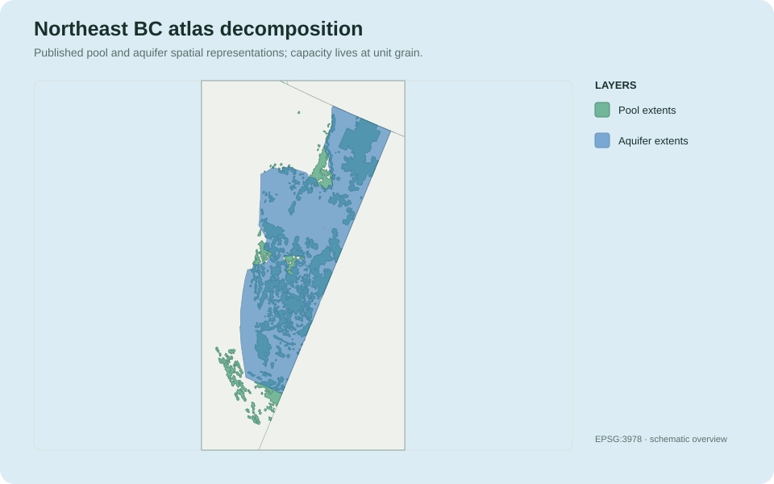
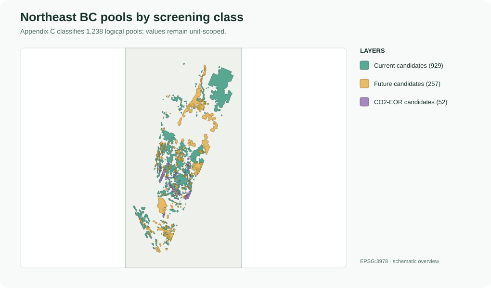
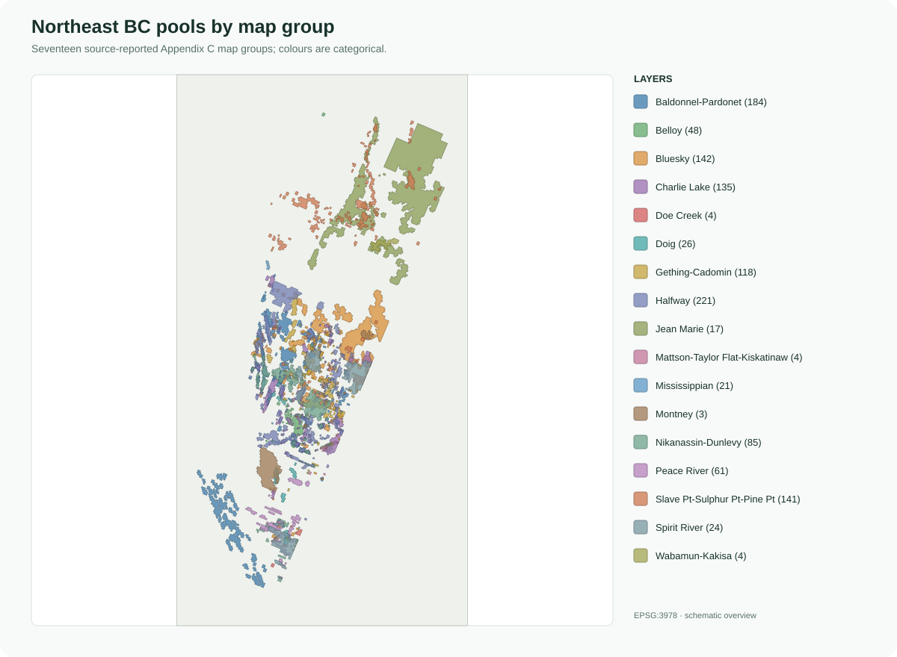
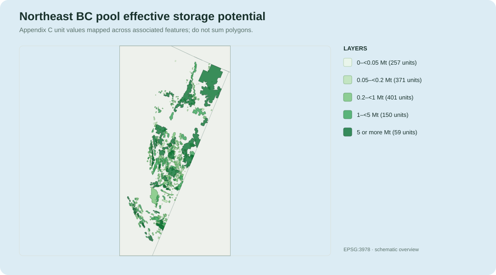
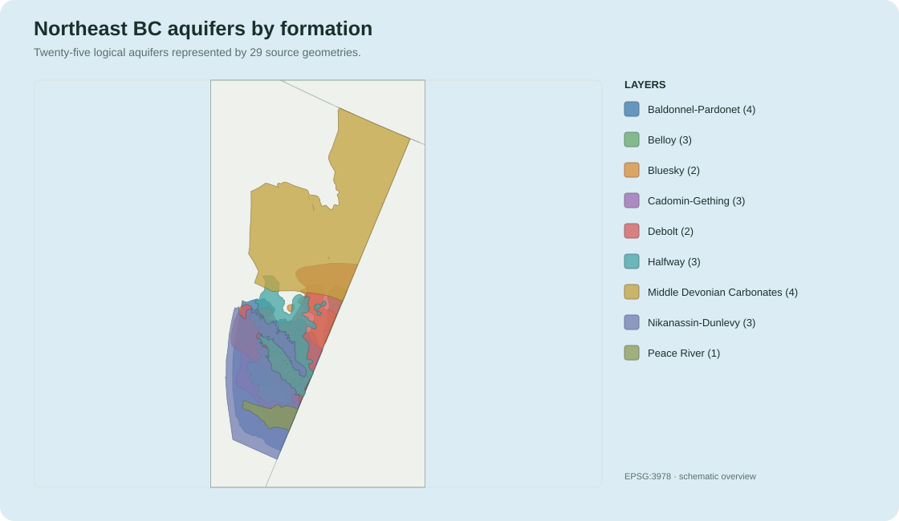
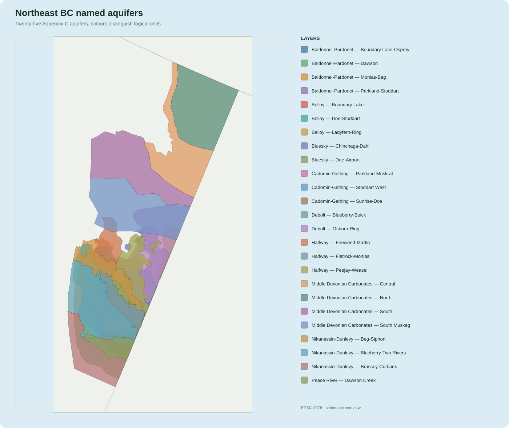
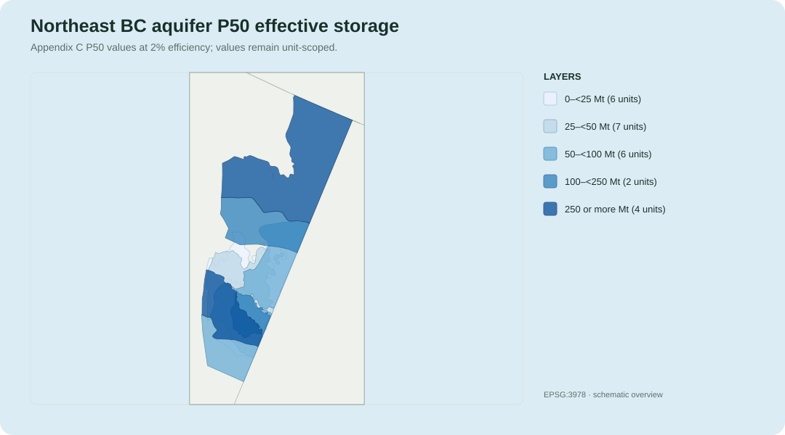

# Northeast BC Geological Carbon Capture and Storage Atlas

This guide explains how the Northeast BC Geological Carbon Capture and Storage
Atlas is represented in CANCO2-Storage. It distinguishes the logical storage
assessments in Appendix C from the geometry and supporting geological layers
in Appendix E, and shows how both become the BC daughter GeoPackage and the
unified Canadian atlas.

Return to the [data catalog](../data-catalog.md) for the relationship between
all four daughter packages and the unified product.

## At a glance

| Property | Description |
| --- | --- |
| Source organization | Geoscience BC |
| Source product | Northeast BC Geological Carbon Capture and Storage Atlas |
| Report | Geoscience BC Report 2023-04 |
| Lead researchers | K. Rakhit and N. Sweet |
| Research organization | Canadian Discovery Ltd. |
| Project page | [Geoscience BC project 2022-001](https://www.geosciencebc.com/projects/2022-001/) |
| Geographic scope | Northeast British Columbia, within the Western Canada Sedimentary Basin |
| Principal source formats | One Appendix C Excel workbook and 109 Appendix E shapefiles |
| Daughter output pattern | `YYYYMMDD_13_BCStorageAtlas_AV.gpkg` |
| Daughter CRS | EPSG:3978 — NAD83 / Canada Atlas Lambert |
| Unified source key | `source_dataset = 'BC_STORAGE_ATLAS'` |
| Assessment type | Quantitative geological storage screening |
| Injectivity | Not quantitatively assessed |

The source evaluates storage **potential**, not demonstrated capacity or
injectivity. Its pool and aquifer estimates support regional screening and
must not be treated as permitted injection volumes or project-ready values.

## Representation hierarchy

The source uses formation or map-group names rather than a row-level basin
field:

```text
Western Canada Sedimentary Basin
└── Northeast British Columbia study area
    └── formation or map group
        ├── depleted or near-depleted pool
        │   ├── one logical Appendix C assessment
        │   └── one or more Appendix E geometries
        └── saline aquifer
            ├── one logical Appendix C assessment
            └── one or more Appendix E geometries
```

The Western Canada Sedimentary Basin is dataset-level context reported by the
project. The current daughter and unified records do not populate
`basin_name`; students should use `formation`, `map_group`, and the logical
unit names rather than assigning a basin value to individual rows.

## Two complementary source components

The Bronze package deliberately retains Appendix C and Appendix E as separate
but related source products.

### Appendix C: logical assessments

The workbook
`Appendix C - Pool Storage Database & Aquifer Storage Summary.xlsx` contains
the preferred logical and quantitative records.

| Worksheet | Daughter table | Role |
| --- | --- | --- |
| `Current CO2 Storage Candidates` | `pool_units` | Current pool candidates |
| `Future CO2 Storage Candidates` | `pool_units` | Future pool candidates |
| `Oil Pools for CO2-EOR Eval` | `pool_units` | Oil pools evaluated for CO2-EOR |
| `Aquifer Storage Summary` | `aquifer_units` | Logical saline-aquifer assessments |

Appendix C is the preferred source for classifications and capacity values.
It supplies one assessment per logical pool or aquifer rather than one value
per polygon.

### Appendix E: geometry and geological context

Appendix E contains 109 shapefiles organized by atlas chapter and a general
folder:

| Appendix E group | Shapefiles |
| --- | ---: |
| Chapter 5 — Peace River | 11 |
| Chapter 6 — Spirit River | 3 |
| Chapter 7 — Bluesky | 11 |
| Chapter 8 — Cadomin-Gething | 14 |
| Chapter 9 — Nikanassin-Dunlevy | 13 |
| Chapter 10 — Baldonnel-Pardonet | 10 |
| Chapter 11 — Charlie Lake | 4 |
| Chapter 12 — Halfway | 9 |
| Chapter 13 — Belloy | 10 |
| Chapter 14 — Debolt | 9 |
| Chapter 15 — Jean Marie | 3 |
| Chapter 16 — Middle Devonian Carbonates | 9 |
| General | 3 |
| **Total** | **109** |

Only 26 of these shapefiles directly create canonical storage geometry. The
remaining 83 provide supporting geological, reservoir, pressure, temperature,
depth, pool-screening, emissions, or map context.

## Which shapefiles become storage geometry?

### Pool master

All canonical pool geometry comes from:

`BCOGC_POOLS_CO2_STORAGE_CDL_83UTM10_PG.shp`

Appendix C field `Code for Link to Shapefile` is matched to source field
`LINK_CODE` in this master shapefile. This produces `pool_features` linked to
the logical `pool_units` assessments.

### Aquifer storage shapefiles

Twenty-five shapefiles are mapped one-to-one to 25 logical aquifer assessments.
Some shapefiles contain multiple geometry features, so one logical aquifer may
still have several spatial records.

| Formation/group | Canonical aquifer shapefiles |
| --- | --- |
| Peace River | `GBCS_PEACE_RIVER_AQUIFER_DAWSON_83UTM10_PG.shp` |
| Bluesky | `GBCS_BLUESKY_AQUIFER_CO2_STORAGE_CHINCHAGA_DAHL_83UTM10_PG.shp`<br>`GBCS_BLUESKY_AQUIFER_CO2_STORAGE_DOE_AIRPORT_83UTM10_PG.shp` |
| Cadomin-Gething | `GBCS_CADOMIN_AQUIFER_PARKLAND_MUSKRAT_83UTM10_PG.shp`<br>`GBCS_CADOMIN_AQUIFER_STODDART_WEST_83UTM10_PG.shp`<br>`GBCS_CADOMIN_AQUIFER_SUNRISE_DOE_83UTM10_PG.shp` |
| Nikanassin-Dunlevy | `GBCS_NIKANASSIN_AQUIFER_BEG_SIPHON_83UTM10_PG.shp`<br>`GBCS_NIKANASSIN_AQUIFER_BLUEBERRY_TWO_RIVERS_83UTM10_PG.shp`<br>`GBCS_NIKANASSIN_AQUIFER_BRASSEY_CUTBANK_83UTM10_PG.shp` |
| Baldonnel-Pardonet | `GBCS_BALDONNEL_AQUIFER_BOUNDARY_LAKE_OSPREY_83UTM10_PG.shp`<br>`GBCS_BALDONNEL_AQUIFER_DAWSON_83UTM10_PG.shp`<br>`GBCS_BALDONNEL_AQUIFER_MONIAS_BEG_83UTM10_PG.shp`<br>`GBCS_BALDONNEL_AQUIFER_PARKLAND_STODDART_83UTM10_PG.shp` |
| Halfway | `GBCS_HALFWAY_AQUIFER_FLATROCK_MONIAS_83UTM10_PG.shp`<br>`GBCS_HALFWAY_AQUIFER_PEEJAY_WEASEL_83UTM10_PG.shp`<br>`GBCS_HALFWAY_AQUIFER_WEST_FIREWEED_83UTM10_PG.shp` |
| Belloy | `GBCS_BELLOY_AQUIFER_BOUNDARY_LAKE_83UTM10_PG.shp`<br>`GBCS_BELLOY_AQUIFER_DOE_STODDART_83UTM10_PG.shp`<br>`GBCS_BELLOY_AQUIFER_LADYFERN_RING_83UTM10_PG.shp` |
| Debolt | `GBCS_DEBOLT_AQUIFER_NORTH_OSBORN_RING_83UTM83_PG.shp`<br>`GBCS_DEBOLT_AQUIFER_WEST_BLUEBERRY_83UTM83_PG.shp` |
| Middle Devonian Carbonates | `GBCS_SLVPT_AQUIFER_NORTH_10UTM83_PG.shp`<br>`GBCS_SLVPT_AQUIFER_CENTRAL_10UTM83_PG.shp`<br>`GBCS_SLVPT_AQUIFER_SOUTH_10UTM83_PG.shp`<br>`GBCS_SLVPT_AQUIFER_SOUTH_MUSKEG_10UTM83_PG.shp` |

Filenames are preserved exactly as published, including inconsistent UTM
tokens and abbreviations.

### Supporting shapefile families

| Source-layer family | Files | Canonical storage feature? | Purpose |
| --- | ---: | --- | --- |
| Pool candidate | 14 | No | Published candidate-pool map layers |
| Pool non-candidate | 14 | No | Published non-candidate-pool map layers |
| Pool commingled support | 4 | No | Commingled-pool context |
| Pool net-reservoir support | 12 | No | Pool-scale net-reservoir context |
| Pool contour support | 1 | No | Pool contour context |
| Net-reservoir support | 9 | No | Formation-scale net-reservoir context |
| Structure support | 9 | No | Structural elevation surfaces or polygons |
| Pressure support | 7 | No | Formation pressure context |
| Temperature support | 4 | No | Formation temperature context |
| Depth support | 6 | No | Depth-screening context |
| Emissions reference | 1 | No | Emissions-site reference layer |
| Other support | 2 | No | Other source context |

These layers remain part of the Bronze source inventory. They are not silently
discarded or reclassified as storage objects, but they are not promoted into
the daughter `pool_features` or `aquifer_features` layers.

## Daughter GeoPackage



| Daughter layer/table | Records in reference build | Spatial? | Record grain |
| --- | ---: | --- | --- |
| `pool_units` | 1,238 | No | One logical pool assessment |
| `pool_features` | 1,309 | Yes | One mapped pool component |
| `aquifer_units` | 25 | No | One logical aquifer assessment |
| `aquifer_features` | 29 | Yes | One mapped aquifer component |
| `metadata_gbc_ne_atlas` | 27 | No | Dataset provenance and interpretation metadata |
| `qa_gbc_ne_atlas` | 21 | No | Reconciliation and geometry QA |

The reference build contains 1,263 logical storage units and 1,338 spatial
features. Counts describe the reproduced artifact and are not part of the
stable schema contract.

## Pool representation

### Candidate classes

| Appendix C class | `pool_class` | Logical pools |
| --- | --- | ---: |
| Current CO2 storage candidates | `current_candidate` | 929 |
| Future CO2 storage candidates | `future_candidate` | 257 |
| Oil pools for CO2-EOR evaluation | `co2_eor_candidate` | 52 |



The colours represent Appendix C screening classes, not differences in
capacity confidence or project readiness.

The unified atlas classifies 1,186 pool units as gas and 52 as oil.

### Pool map groups

The logical pool database contains 17 source-reported `map_group` values:

| Map group | Logical pools | Map group | Logical pools |
| --- | ---: | --- | ---: |
| Halfway | 221 | Doig | 26 |
| Baldonnel-Pardonet | 184 | Spirit River | 24 |
| Bluesky | 142 | Mississippian | 21 |
| Slave Pt-Sulphur Pt-Pine Pt | 141 | Jean Marie | 17 |
| Charlie Lake | 135 | Wabamun-Kakisa | 4 |
| Gething-Cadomin | 118 | Mattson-Taylor Flat-Kiskatinaw | 4 |
| Nikanassin-Dunlevy | 85 | Doe Creek | 4 |
| Peace River | 61 | Montney | 3 |
| Belloy | 48 |  |  |



These source values are more granular than a single report-level list of
formation chapters. Preserve them as source terminology rather than forcing a
one-to-one chapter crosswalk.

### Pool information coverage

Every pool unit in the reference build has non-null values for:

- formation;
- well count;
- initial pressure;
- temperature;
- porosity;
- pool datum true vertical depth;
- CO2 phase;
- theoretical storage potential;
- effective storage potential; and
- recovery factor.

Appendix C values are authoritative for logical pool assessment. The master
shapefile's source-native theoretical and effective values remain on
`pool_features` for traceability and comparison; they must not be summed once
per geometry.



The classified map repeats each logical unit's value across its associated
geometry solely for display. Its polygons must not be summed to calculate
regional storage potential.

### Multiple pool geometries

Seventy-one logical pools have more than one spatial feature. The source link
code matches all selected Appendix C pool records to the master geometry, but
the geometry count is not a multiplier for capacity.

## Aquifer representation

### Formation and aquifer inventory

| Formation/group | Logical aquifers | Named aquifers |
| --- | ---: | --- |
| Peace River | 1 | Dawson Creek |
| Bluesky | 2 | Chinchaga-Dahl; Doe-Airport |
| Cadomin-Gething | 3 | Parkland-Muskrat; Stoddart West; Sunrise-Doe |
| Nikanassin-Dunlevy | 3 | Beg-Siphon; Blueberry-Two Rivers; Brassey-Cutbank |
| Baldonnel-Pardonet | 4 | Boundary Lake-Osprey; Dawson; Monias-Beg; Parkland-Stoddart |
| Halfway | 3 | Fireweed-Martin; Flatrock-Monias; Peejay-Weasel |
| Belloy | 3 | Boundary Lake; Doe-Stoddart; Ladyfern-Ring |
| Debolt | 2 | Blueberry-Buick; Osborn-Ring |
| Middle Devonian Carbonates | 4 | North; Central; South; South Muskeg |





The formation map emphasizes the geological grouping; the named-aquifer map
separates the 25 logical Appendix C units. Overlap on these maps represents
different source aquifers occupying the same regional footprint, not duplicate
records.

All 25 logical aquifers have source-reported ranges for thickness, pressure,
temperature, and porosity, plus CO2 phase and P10/P50/P90 effective-storage
estimates.

### Aquifer storage estimates

Appendix C reports effective storage at three efficiencies:

| Daughter field | Interpretation |
| --- | --- |
| `p10_effective_storage_mt` | P10 effective storage at 0.5% efficiency |
| `p50_effective_storage_mt` | P50 effective storage at 2% efficiency |
| `p90_effective_storage_mt` | P90 effective storage at 5.4% efficiency |
| `theoretical_storage_mt` | Standardized theoretical storage derived as Appendix C P50 divided by 0.02 |



This map uses the Appendix C P50 effective-storage estimate at 2% efficiency.
Values remain attached to logical aquifers even when an aquifer has several
geometry features.

The raw aquifer shapefiles also contain capacity fields, but Appendix C is the
preferred tabular source because the shapefiles have schema variation and
known discrepancies.

### Source anomalies retained for QA

- Eight aquifers have a source-shapefile theoretical value of zero while
  effective-storage values are nonzero.
- Three Nikanassin-Dunlevy aquifers have source-shapefile P10/P50/P90 values
  that do not match Appendix C within the harmonization tolerance.
- Two invalid source geometries were repaired successfully.
- Two aquifers have three geometry features each; the other 23 have one.

The standardized logical values are not silently replaced with conflicting
shapefile values. The raw values and comparison flags remain available for
provenance and QA.

## Attribute and estimate availability

| Representation | Geometry | Quantitative storage | Estimate grain | Geological/reservoir information | Formation/group |
| --- | --- | --- | --- | --- | --- |
| `pool_units` | No | Theoretical and effective | Logical unit | Pressure, temperature, porosity, depth, production/injection and pool attributes | `formation`, `map_group` |
| `pool_features` | Yes | Source-native copies retained for QA | Do not aggregate from features | Source pool name, formation, fluid type and geometry attributes | Source formation |
| `aquifer_units` | No | P10/P50/P90 effective and derived theoretical | Logical unit | Thickness, pressure, temperature and porosity ranges; CO2 phase | `formation` |
| `aquifer_features` | Yes | Source-native copies retained for QA | Do not aggregate from features | Source identifiers, phase and geometry attributes | Linked through logical unit |

Missing values remain null. The harmonizer does not infer reservoir properties
from neighbouring polygons or supporting map layers.

## Unified representation

| Daughter table | Unified table | Unified `source_layer` | Records | Join key |
| --- | --- | --- | ---: | --- |
| `pool_units` | `storage_units` | — | 1,238 | `storage_unit_id` |
| `pool_units` | `storage_assessments` | `pool_units` | 1,238 | `storage_unit_id` |
| `pool_features` | `storage_features` | `pool_features` | 1,309 | `storage_feature_id`, `storage_unit_id` |
| `aquifer_units` | `storage_units` | — | 25 | `storage_unit_id` |
| `aquifer_units` | `storage_assessments` | `aquifer_units` | 25 | `storage_unit_id` |
| `aquifer_features` | `storage_features` | `aquifer_features` | 29 | `storage_feature_id`, `storage_unit_id` |

All 1,263 BC assessments use `assessment_scope = 'unit'`.

The unified pool assessments retain theoretical and effective storage,
temperature, and porosity. The unified aquifer assessments retain
P10/P50/P90 and theoretical storage. Range-valued aquifer properties and the
richer pool production and reservoir fields remain in the daughter package
because they do not map cleanly to the canonical scalar fields.

## Raw-to-unified lineage

```text
Appendix C pool worksheets
→ pool_units
→ storage_units + unit-scoped storage_assessments

Appendix E master pool shapefile
→ pool_features
→ storage_features

Appendix C Aquifer Storage Summary
→ aquifer_units
→ storage_units + unit-scoped storage_assessments

25 Appendix E aquifer shapefiles
→ aquifer_features
→ storage_features

83 Appendix E support shapefiles
→ Bronze inventory and source-schema documentation
→ not promoted to canonical storage features
```

## Recommended filters and joins

Select every BC storage geometry in `storage_features` with:

```sql
source_dataset = 'BC_STORAGE_ATLAS'
```

Select pools or aquifers with `source_layer`:

```sql
source_dataset = 'BC_STORAGE_ATLAS'
AND source_layer = 'pool_features'
```

```sql
source_dataset = 'BC_STORAGE_ATLAS'
AND source_layer = 'aquifer_features'
```

For estimates, query `storage_assessments` with `source_layer = 'pool_units'`
or `source_layer = 'aquifer_units'`, then join to `storage_units` using
`storage_unit_id`.

Use `formation` in unified `storage_units` for formation-level selection. Use
the daughter package when the analysis requires `map_group`, property ranges,
production history, source-shapefile values, or QA comparison flags.

Detailed ArcGIS Pro, QGIS, GeoPandas, and SQLite procedures will be maintained
in the [query guide](../quickstart.md).

## Interpretation checklist

Before using or aggregating the BC atlas, confirm that:

- capacity is taken from logical unit tables or unit-scoped assessments;
- multiple spatial features have not multiplied a unit's estimate;
- pool and aquifer estimates have not been treated as identical methods;
- aquifer P10/P50/P90 values are described with their source efficiencies;
- Appendix C is used as the preferred capacity source;
- known shapefile anomalies and mismatches have been reviewed when relevant;
- support layers have not been reinterpreted as storage objects;
- source map groups and formations have not been forced into an undocumented
  basin hierarchy; and
- storage potential has not been described as demonstrated or permitted
  capacity.

## Provenance and package documentation

The daughter GeoPackage registers `metadata_gbc_ne_atlas` and
`qa_gbc_ne_atlas` as authoritative package tables. Its generated README and
CSV sidecars record the exact build date, source schemas, QA results, field
definitions, and counts for a particular artifact.

This guide is intentionally stable and uses filename patterns rather than
personal paths or machine-specific locations. Build-specific documentation
belongs beside the generated GeoPackage.

See the [schema contract](../schema.md) for stable unified field meanings.
