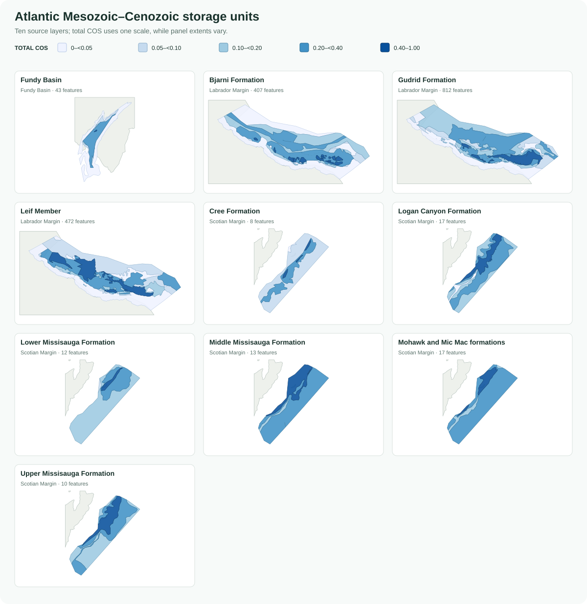
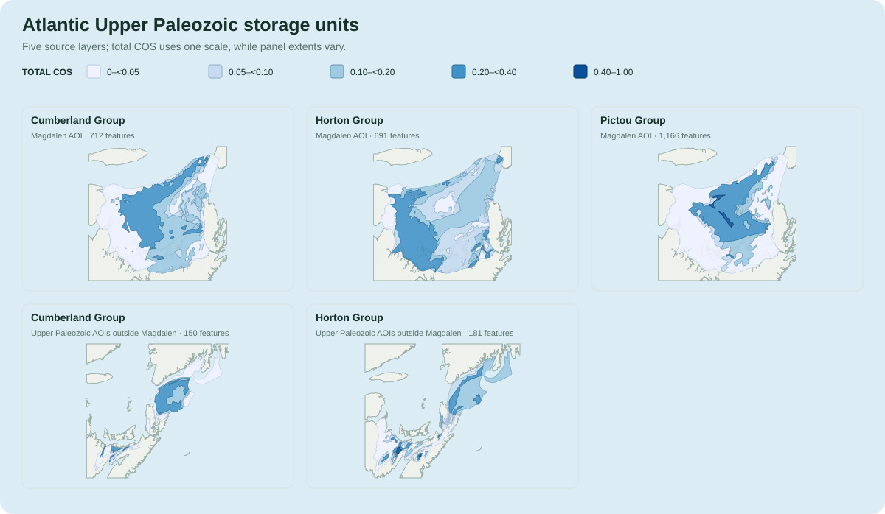

# GSC Atlantic Open File 8996

This guide describes how the 15 Geological Survey of Canada Chance of Success
(COS) shapefiles are preserved in the Atlantic daughter GeoPackage and
represented in the unified Canadian atlas.

## At a glance

| Item | Value |
| --- | --- |
| Source organization | Natural Resources Canada, Geological Survey of Canada |
| Source product | *Preliminary assessment of geological carbon-storage potential of Atlantic Canada* |
| Series | Geological Survey of Canada Open File 8996 |
| Geographic scope | Atlantic Canada and adjacent offshore assessment areas |
| Published date | 2023 |
| Data current as of | Not separately stated in the source metadata |
| Update cadence | Static publication |
| Source access | [Government of Canada publication record](https://ostrnrcan-dostrncan.canada.ca/entities/publication/b6140ab8-c5fd-4ad2-b9ed-65c32ff2bb17) |
| DOI | [10.4095/332145](https://doi.org/10.4095/332145) |
| Licence | [Open Government Licence – Canada](https://open.canada.ca/en/open-government-licence-canada) |
| Primary source content | 15 polygon shapefiles |
| Daughter output | <code>YYYYMMDD_13_AtlanticStorageCOS_AV.gpkg</code> |
| Daughter contents | <code>storage_units</code>, containing 4,711 source polygons |
| Daughter CRS | EPSG:3978 — NAD83 / Canada Atlas Lambert |
| Unified source key | <code>source_dataset = 'ATLANTIC_COS'</code> |
| Data class | <code>geological_prospectivity</code> |
| Assessment type | <code>qualitative_chance_of_success</code> |
| Capacity / injectivity | No capacity data; injectivity not quantitatively assessed |

COS expresses geological Chance of Success. It is not a storage-capacity
estimate, an injectivity value, a permitted resource, or a project-readiness
assessment. No Atlantic COS value should be reported in tonnes of CO2.

## Source hierarchy

The source can be understood as:

~~~text
Open File 8996
├── Mesozoic–Cenozoic package
│   ├── Fundy Basin
│   ├── Labrador Margin
│   └── Scotian Margin
└── Upper Paleozoic package
    ├── Magdalen area of interest
    └── areas of interest outside Magdalen
        └── geological unit / source shapefile
            └── individual COS polygon
~~~

There are 10 Mesozoic–Cenozoic source layers and 5 Upper Paleozoic layers.
The same geological name can occur in more than one assessment area. For
example, the Cumberland and Horton groups each have separate Magdalen and
non-Magdalen logical units. Use <code>storage_unit_id</code>, not the display
name alone, as the stable identity.

## Source shapefiles

R, S, and T in the table mean reservoir, seal, and trap COS. Feature counts
refer to the current reference build.

| Geological group | Assessment area | Logical storage unit | Raw shapefile | COS components | Features |
| --- | --- | --- | --- | --- | ---: |
| Mesozoic–Cenozoic | Fundy Basin | Fundy Basin | <code>Fundy.shp</code> | R, S, T | 43 |
| Mesozoic–Cenozoic | Labrador Margin | Bjarni Formation | <code>Bjarni.shp</code> | R, S, T | 407 |
| Mesozoic–Cenozoic | Labrador Margin | Gudrid Formation | <code>Gudrid.shp</code> | R, S, T | 812 |
| Mesozoic–Cenozoic | Labrador Margin | Leif Member | <code>Leif.shp</code> | R, S, T | 472 |
| Mesozoic–Cenozoic | Scotian Margin | Cree Formation | <code>LATE_ALBIAN_CREE_TOTAL.shp</code> | R, S | 8 |
| Mesozoic–Cenozoic | Scotian Margin | Logan Canyon Formation | <code>ALBIAN_LOGAN_CANYON_TOTAL.shp</code> | R, S | 17 |
| Mesozoic–Cenozoic | Scotian Margin | Lower Missisauga Formation | <code>BERRIASIAN_LOWER_MISSISAUGA_TOTAL.shp</code> | R, S | 12 |
| Mesozoic–Cenozoic | Scotian Margin | Middle Missisauga Formation | <code>VALANGINIAN_HAUTERIVIAN_MID_MISSISAUGA_TOTAL.shp</code> | R, S | 13 |
| Mesozoic–Cenozoic | Scotian Margin | Mohawk and Mic Mac formations | <code>UPPER_JURASSIC_MOHAWK_MIC_MAC_TOTAL.shp</code> | R, S | 17 |
| Mesozoic–Cenozoic | Scotian Margin | Upper Missisauga Formation | <code>BARREMIAN_UPPER_MISSISAUGA_TOTAL.shp</code> | R, S | 10 |
| Upper Paleozoic | Magdalen AOI | Cumberland Group | <code>Magdalen_Cumberland.shp</code> | R, S, T | 712 |
| Upper Paleozoic | Magdalen AOI | Horton Group | <code>Magdalen_Horton.shp</code> | R, S, T | 691 |
| Upper Paleozoic | Magdalen AOI | Pictou Group | <code>Pictou.shp</code> | R, S, T | 1,166 |
| Upper Paleozoic | Outside Magdalen | Cumberland Group | <code>Cumberland_non_Magdalen.shp</code> | R, S, T | 150 |
| Upper Paleozoic | Outside Magdalen | Horton Group | <code>Horton_non_Magdalen.shp</code> | R, S, T | 181 |

The Bronze workflow retains each shapefile and its required sidecars unchanged.
The harmonizer validates all 15 expected filenames and their source-specific
field mappings before building the daughter package.

## Spatial decomposition and total COS

Every panel uses the same total-COS classes, but its map extent is fitted to
that source layer. Compare colors directly between panels; do not compare the
apparent map size without accounting for the varying panel extents.

The figures also show why the 15 layers remain distinct. Several units occupy
the same assessment area and may overlap or be vertically stacked. Their
polygons are alternative geological plays or units, not pieces of one
non-overlapping surface.

## Chance of Success fields

The source shapefiles use different field names for equivalent concepts. The
daughter layer standardizes them as:

| Daughter field | Meaning |
| --- | --- |
| <code>reservoir_cos</code> | Source-reported reservoir Chance of Success |
| <code>seal_cos</code> | Source-reported seal Chance of Success |
| <code>trap_cos</code> | Source-reported trap Chance of Success, where supplied |
| <code>total_cos</code> | Source-reported combined Chance of Success |
| <code>cos_components</code> | Components explicitly represented by the source layer |

All 4,711 features contain reservoir, seal, and total COS. Trap COS is null for
77 features: the five Scotian-margin layers explicitly supply reservoir and
seal components but no separate trap field. Those nulls mean “not supplied as
a separate source attribute,” not a trap COS of zero.

The harmonizer preserves the published <code>total_cos</code>. It does not
recalculate total COS from the standardized component fields. This matters
because the publication's source layers are authoritative and their component
structures are not identical.

## Daughter GeoPackage

The dated artifact follows this naming pattern:

~~~text
YYYYMMDD_13_AtlanticStorageCOS_AV.gpkg
~~~

Its registered contents are:

| Layer or table | Records | Spatial? | Meaning |
| --- | ---: | --- | --- |
| <code>storage_units</code> | 4,711 | Yes | Preserved source polygons with standardized identity and COS fields |
| <code>metadata_gsc_atlantic</code> | 28 | No | Provenance, classification, licence, and interpretation |
| <code>qa_gsc_atlantic</code> | 12 | No | Feature counts, field coverage, CRS, and geometry validation |

Despite its daughter-layer name, <code>storage_units</code> has one row per
source polygon, not one row per logical geological unit. The 4,711 rows share
15 stable <code>storage_unit_id</code> values. This source-faithful structure is
split into logical units, geometries, and assessments only when the unified
atlas is built.

The daughter package also has sidecar CSV files for source-schema inventory,
source metadata, QA details, and the harmonized field dictionary.

## Geometry handling

The daughter workflow:

1. reads every source polygon without dissolving it;
2. preserves the source filename and feature identifier;
3. repairs invalid geometry only when required;
4. reprojects the geometry to EPSG:3978;
5. validates the persisted GeoPackage after writing it.

The current reference build contains no null or invalid final geometries.
Geometry area and perimeter fields describe each polygon. They must not be
summed across overlapping units to infer unique Atlantic storage area.

## Unified atlas representation

The Atlantic daughter becomes three canonical unified tables:

| Unified table | Atlantic records | Grain |
| --- | ---: | --- |
| <code>storage_units</code> | 15 | One logical geological unit in one assessment area |
| <code>storage_features</code> | 4,711 | One preserved source polygon |
| <code>storage_assessments</code> | 4,711 | One feature-scoped COS assessment |

All three use <code>source_dataset = 'ATLANTIC_COS'</code>. Atlantic features
and assessments use <code>source_layer = 'storage_units'</code>, reflecting the
daughter layer from which they came.

The lineage is:

~~~text
source shapefile row
    └── daughter storage_units row
        ├── unified storage_unit (shared by the unit's polygons)
        ├── unified storage_feature (one geometry)
        └── unified storage_assessment (one feature-scoped COS record)
~~~

The assessment scope is <code>feature</code>. Join an Atlantic assessment to
geometry with <code>storage_feature_id</code>; join the logical unit name and
geological group with <code>storage_unit_id</code>.

## Query example

~~~python
import geopandas as gpd

units = gpd.read_file(
    package, layer="storage_units", ignore_geometry=True
)
features = gpd.read_file(package, layer="storage_features")
assessments = gpd.read_file(
    package, layer="storage_assessments", ignore_geometry=True
)

atlantic_units = units.loc[
    units["source_dataset"].eq("ATLANTIC_COS")
]
atlantic_features = features.loc[
    features["source_dataset"].eq("ATLANTIC_COS")
]
atlantic_assessments = assessments.loc[
    assessments["source_dataset"].eq("ATLANTIC_COS")
]

mapped = atlantic_features.merge(
    atlantic_assessments[
        [
            "storage_feature_id",
            "reservoir_cos",
            "seal_cos",
            "trap_cos",
            "total_cos",
        ]
    ],
    on="storage_feature_id",
    how="left",
    validate="one_to_one",
).merge(
    atlantic_units[
        [
            "storage_unit_id",
            "storage_name",
            "geological_group",
        ]
    ],
    on="storage_unit_id",
    how="left",
    validate="many_to_one",
)
~~~

In ArcGIS Pro or QGIS, apply the same two joins:

- join <code>storage_assessments</code> to
  <code>storage_features</code> with <code>storage_feature_id</code>;
- join <code>storage_units</code> to <code>storage_features</code> with
  <code>storage_unit_id</code>.

Filter <code>source_dataset</code> to <code>ATLANTIC_COS</code> before
interpreting the COS fields.

## Interpretation guardrails

- COS is geological prospectivity, not quantified capacity or injectivity.
- A null trap COS is missing as a separate source component, not zero.
- Source-reported total COS is preserved rather than recomputed.
- Similar or overlapping polygons can represent different geological units.
- Polygon areas are not additive across the 15 units.
- Geographic overlap with another daughter dataset does not establish that the
  records describe the same storage unit.
- Use the source publication for the geological methodology and the GeoPackage
  metadata and QA tables for processing provenance.
