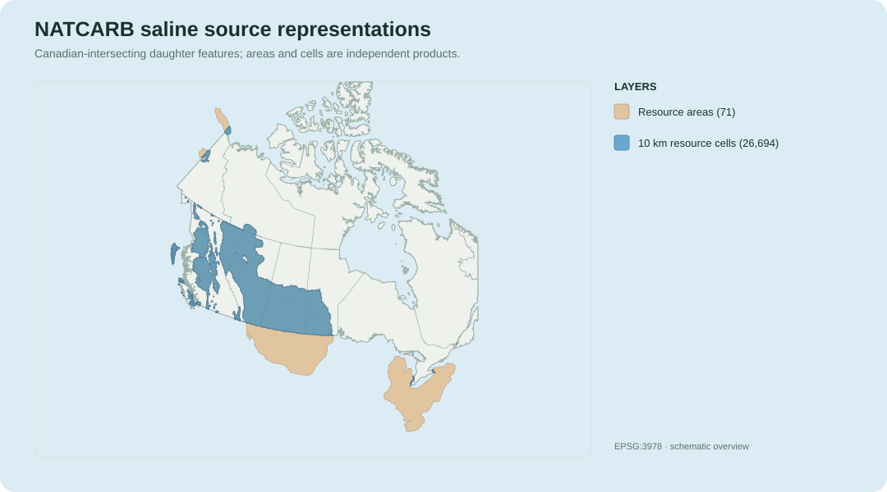
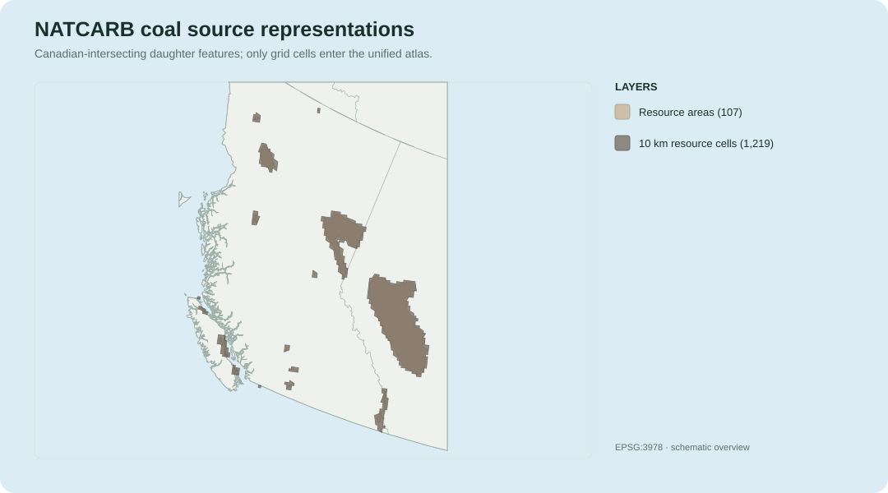
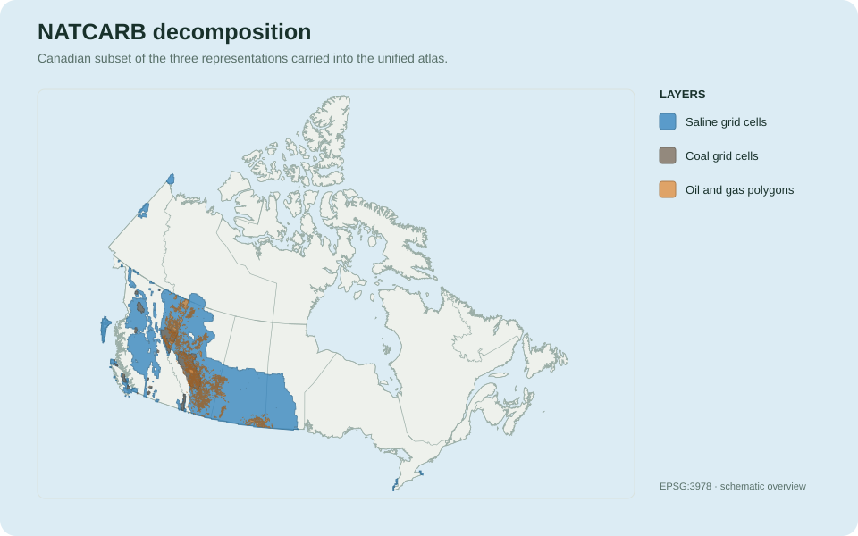
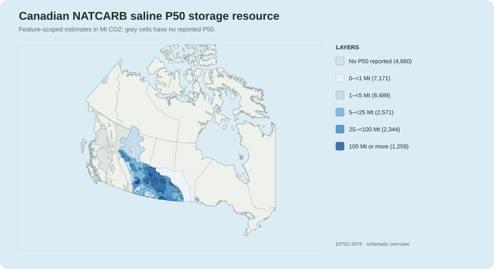
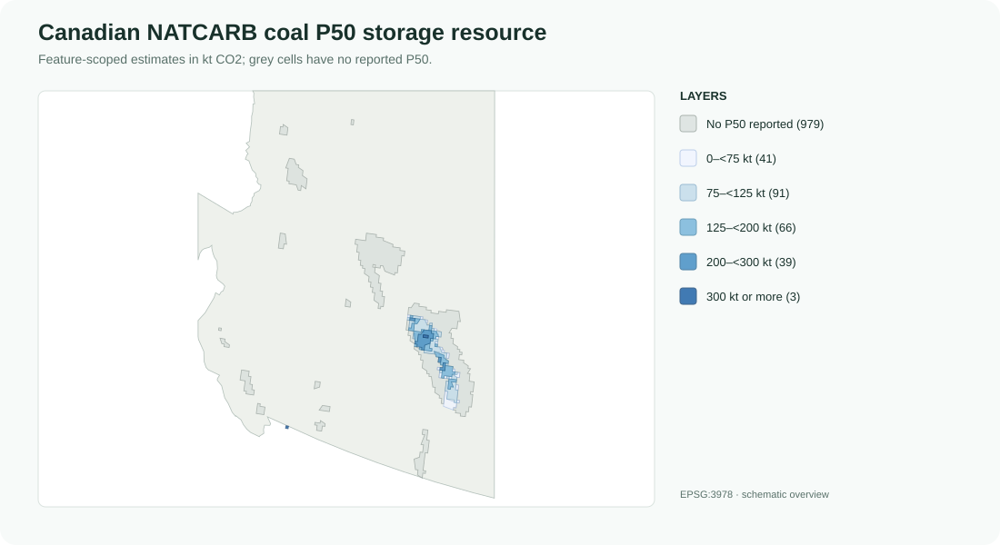
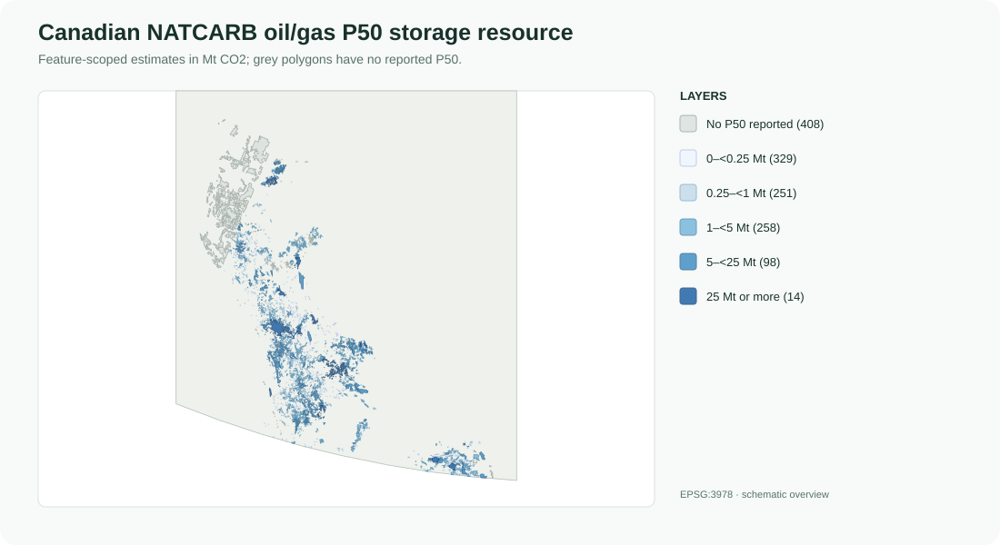
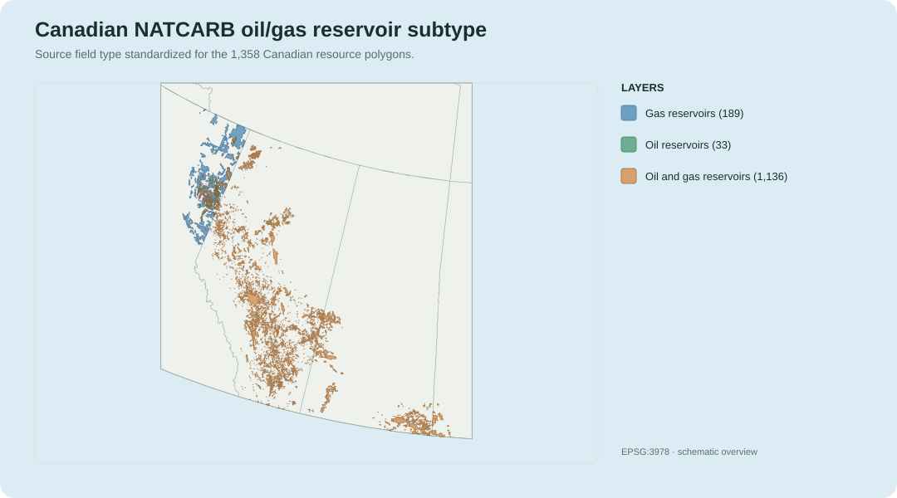

# DOE/NETL NATCARB v1502

This guide explains how the DOE/NETL NATCARB v1502 source is represented in
CANCO2-Storage, which layers carry storage estimates or geological attributes,
and how the Canadian subset is incorporated into the unified atlas.

Return to the [data catalog](../data-catalog.md) for the relationship between
all four daughter packages and the unified product.

## At a glance

| Property | Description |
| --- | --- |
| Source | U.S. Department of Energy (DOE) — National Energy Technology Laboratory (NETL) |
| Source product | NATCARB All Data v1502 |
| Source date | May 14, 2015 |
| Current documentation | [NETL NATCARB interactive experience](https://arcgis.netl.doe.gov/portal/apps/experiencebuilder/experience/?id=ea8e3add7d6844ba8768af930e5e7f2a) |
| v1502 dataset record | [NATCARB All Data v1502 on NETL EDX](https://edx.netl.doe.gov/dataset/natcarb-alldata-v1502) |
| General dataset record | [NATCARB on NETL EDX](https://edx.netl.doe.gov/dataset/natcarb) |
| DOI | [10.18141/1474110](https://doi.org/10.18141/1474110) |
| Recommended citation | Bauer, J., Rowan, C., Barkhurst, A., Digiulio, J., Jones, K., Sabbatino, M., Rose, K., and Wingo, P. (2018-09-27). *NATCARB*. |
| Primary source format | Esri File Geodatabase |
| Source extent | United States and parts of Canada |
| Daughter output pattern | `YYYYMMDD_13_NATCARBStorage_AV.gpkg` |
| Daughter CRS | EPSG:3978 — NAD83 / Canada Atlas Lambert |
| Unified source key | `source_dataset = 'NATCARB'` |
| Assessment type | Quantitative geological storage resource |
| Injectivity | Not quantitatively assessed |

NATCARB is intended for regional- to continental-scale screening. Its storage
resource estimates are not permitted injection capacity, demonstrated
injectivity, project-ready capacity, or a replacement for site-specific
characterization.

## Representation hierarchy

NATCARB does not use one uniform geological hierarchy. The appropriate
selection fields depend on the resource type:

```text
Saline
└── partnership
    └── basin_name, where reported
        └── resource_name
            ├── 10 km resource grid cells
            └── resource-area polygon

Coal
└── partnership
    └── resource_name
        ├── 10 km resource grid cells
        └── resource-area polygon

Oil and gas
└── partnership
    └── field_name
        └── reservoir_number or reservoir_name, where reported
            └── storage-resource polygon
```

`basin_name` is a source-reported field in the saline layers. It is not
available as a corresponding field in the NATCARB coal or oil/gas layers, so
basin membership must not be inferred for those resources without a separate,
documented basin-boundary workflow.

## Source package

The Bronze package preserves the original archive, the File Geodatabase
`NATCARB_v1502.gdb`, and the provider metadata files. It is not converted to
shapefiles before harmonization.

### Geological storage feature classes

| Source feature class | Geometry | Source representation | Daughter layer | Included in unified? |
| --- | --- | --- | --- | --- |
| `NATCARB_Saline_10K_v1502` | Polygon | Saline resource by 10 km analytical grid cell | `saline_resource_cells` | Canadian subset |
| `NATCARB_Saline_Poly_v1502` | Polygon | Saline resource extent | `saline_resource_areas` | No |
| `NATCARB_Coal_10K_v1502` | Polygon | Coal resource by 10 km analytical grid cell | `coal_resource_cells` | Canadian subset |
| `NATCARB_Coal_Poly_v1502` | Polygon | Coal resource extent | `coal_resource_areas` | No |
| `NATCARB_OilGas_v1502` | Polygon | Oil/gas field or reservoir storage resource | `oil_gas_resources` | Canadian subset |

The grid and area products are retained as independent source
representations. The source attributes do not provide a universally reliable
key that would support treating an area polygon as the parent of every grid
cell.





These maps show daughter features whose source geometry intersects Canada.
They illustrate why the polygon and grid products must not be treated as
different resolutions of one interchangeable layer: each is an independent
source representation. Intersecting source geometries are shown in full, so
some polygons extend across the national boundary.

### Other spatial feature classes

| Source feature class | Geometry | Treatment |
| --- | --- | --- |
| `NATCARB_Sources2011_v1502` | Point | Source/reference layer; not promoted to the daughter GeoPackage |
| `NATCARB_Sources2012_v1502` | Point | Source/reference layer; not promoted to the daughter GeoPackage |
| `NATCARB_Sources2013_v1502` | Point | Source/reference layer; not promoted to the daughter GeoPackage |

These point layers describe source/reference information rather than
geological storage-resource geometry.

### Provider domain tables

Ten coded-value tables are normalized and registered in the daughter
GeoPackage:

| Daughter table | Interprets |
| --- | --- |
| `domain_state` | State or province codes |
| `domain_fuel` | Fuel codes |
| `domain_overlap` | Provider overlap flag |
| `domain_duplicate` | Provider duplicate flag |
| `domain_arra` | ARRA project codes |
| `domain_source_types` | Source-type codes |
| `domain_med_calced` | Medium-estimate calculation method |
| `domain_partnership` | Regional Carbon Sequestration Partnership codes |
| `domain_oil_gas` | Oil/gas field types |
| `domain_assessed` | Assessed-status values |

These tables are essential for interpreting the source codes. They are
retained in the daughter package but are not copied into the unified atlas as
standalone tables.

## Daughter GeoPackage

The daughter GeoPackage preserves the five storage-resource representations,
provider flags, standardized estimates, available geological attributes,
source identifiers, domain tables, metadata, and QA.

| Daughter layer | Representation | Records in reference build | Direct estimates? |
| --- | --- | ---: | --- |
| `saline_resource_cells` | `resource_grid_cell` | 186,675 | Yes, where assessed |
| `saline_resource_areas` | `resource_extent` | 508 | No |
| `coal_resource_cells` | `resource_grid_cell` | 17,975 | Yes, where assessed |
| `coal_resource_areas` | `resource_extent` | 310 | No |
| `oil_gas_resources` | `storage_resource` | 68,634 | Yes, where assessed |

The reference build contains 274,102 spatial features. Counts are included to
show relative scale and data coverage; they are not part of the stable schema
contract.

## What information is available?

### Layer-level availability

| Representation | Basin name | Resource/field identity | P10/P50/P90 | Depth | Thickness | Pressure and temperature | Porosity | Permeability |
| --- | --- | --- | --- | --- | --- | --- | --- | --- |
| Saline grid cells | Some records | `resource_name` | Some records | Some records | Some records | Some records | Some records | Some records |
| Saline resource areas | Some records | `resource_name` | No | No | No | No | No | No |
| Coal grid cells | No basin field | `resource_name` | Some records | Column present but empty | Some records | No fields | No field | No field |
| Coal resource areas | No basin field | `resource_name` | No | No | No | No | No | No |
| Oil/gas resources | No basin field | `field_name`, reservoir fields | Some records | Some records | Some records | Some records | Some records | Column present but empty |

“Some records” is intentional. Missing provider values remain null; the
harmonizer does not impute geological properties or storage estimates.

### Quantified coverage in the full daughter package

| Layer | Records | P10 | P50 | P90 | Depth | Thickness | Pressure | Temperature | Porosity | Permeability |
| --- | ---: | ---: | ---: | ---: | ---: | ---: | ---: | ---: | ---: | ---: |
| Saline grid cells | 186,675 | 170,449 | 170,449 | 170,449 | 138,295 | 137,983 | 65,456 | 65,456 | 84,268 | 16,729 |
| Coal grid cells | 17,975 | 15,374 | 15,374 | 15,374 | 0 | 2,251 | — | — | — | — |
| Oil/gas resources | 68,634 | 64,734 | 64,734 | 64,733 | 54,313 | 18,292 | 48,509 | 48,514 | 15,481 | 0 |

Additional saline coverage includes 16,020 salinity values. Oil/gas includes
6,168 salinity values. The source does not provide one complete suite of
geological properties for every assessed resource.

## Storage estimates and provider flags

The quantitative layers preserve three provider storage-resource fields:

| Harmonized field | Meaning in this package |
| --- | --- |
| `storage_p10_tonnes` | Provider low estimate, in metric tonnes of CO2 |
| `storage_p50_tonnes` | Provider medium estimate, in metric tonnes of CO2 |
| `storage_p90_tonnes` | Provider high estimate, in metric tonnes of CO2 |

The estimates are feature-scoped. A value belongs to the specific grid-cell
resource or oil/gas polygon on that row.

Before aggregating estimates, inspect:

| Field | Why it matters |
| --- | --- |
| `assessed` | `False` identifies resources that NATCARB did not assess; estimate fields should be null |
| `overlap` | Identifies a resource overlapping an adjacent partnership resource |
| `duplicate` | Identifies provider-flagged duplicate adjacent-partnership data |
| `p50_method` | Distinguishes a provider-supplied medium estimate from one calculated from the low and high estimates |
| `partnership` | Helps identify records contributed through different regional partnerships |

Provider-flagged overlapping and duplicate records are deliberately retained
for provenance. Neither the daughter package nor the unified atlas silently
deduplicates them.

`grid_cell_id` preserves the provider `COL_ROW` value. It identifies a NATCARB
analytical grid cell, but it is not a unique feature key because several
geological resources may occupy the same cell. Use `natcarb_id` in the daughter
package and `storage_feature_id` in the unified atlas as feature identifiers.

## Canadian unified subset



Only three daughter layers enter the unified atlas:

| Daughter layer | Unified `source_layer` | Canadian features | Logical units | Assessments |
| --- | --- | ---: | ---: | ---: |
| `saline_resource_cells` | `saline_resource_cells` | 26,694 | 99 | 26,694 |
| `coal_resource_cells` | `coal_resource_cells` | 1,219 | 108 | 1,219 |
| `oil_gas_resources` | `oil_gas_resources` | 1,358 | 1,358 | 1,358 |

The area layers are preserved in the daughter package but omitted from the
unified atlas. This avoids presenting two non-equivalent source
representations as interchangeable canonical features.

### How the Canadian subset is selected

- Saline and coal grid-cell records are retained when their geometry
  intersects the Statistics Canada province and territory boundary.
- The intersecting source geometry is retained; it is not clipped to the
  national boundary.
- Province and territory membership is summarized from spatial intersection.
- Oil/gas records are selected using the source-reported state/province code.

This difference is recorded because saline and coal lack an equivalent
source-jurisdiction field suitable for the same selection method.

### Estimate and geological coverage in the Canadian subset

| Unified representation | Features | P10/P50/P90 present | Geological-property coverage |
| --- | ---: | ---: | --- |
| Saline grid cells | 26,694 | 21,834 | Depth 10,247; thickness 10,214; salinity and permeability 8,483; pressure and temperature 9,801; porosity 9,809 |
| Coal grid cells | 1,219 | 240 | Standardized geological-property fields are null for the selected Canadian rows |
| Oil/gas resources | 1,358 | 950 | Standardized depth, thickness, salinity, pressure, temperature, porosity, and permeability are null for the selected Canadian rows |

The full daughter package therefore contains richer geological-property
coverage than the Canadian subset for some resource types. Students should use
the daughter package when investigating source-wide geological attributes and
the unified atlas when comparing the Canadian canonical representations.

### P50 storage-resource distribution







Each map classifies the P50 value attached to an individual unified feature.
Grey means that NATCARB did not report a P50 value for that feature; it does
not mean zero storage. Saline and oil/gas values are displayed in megatonnes,
whereas coal values are displayed in kilotonnes. The class breaks are tailored
to each resource type, so colors should be compared within a map, not between
the three maps. Provider overlap and duplicate flags remain relevant before
any feature values are summed.

### Oil and gas reservoir subtype



The oil/gas layer can be decomposed one level further using the provider field
type. The unified `storage_subtype` values distinguish gas reservoirs, oil
reservoirs, and combined oil-and-gas reservoirs. This is the most defensible
additional spatial split available without inventing basin membership or
sub-reservoir relationships that the source does not consistently encode.

### Basin names in the Canadian subset

Only 36 of the 1,565 Canadian NATCARB logical units have a non-null,
source-reported `basin_name`:

| Source-reported basin | Logical units |
| --- | ---: |
| Central Montana Uplift | 14 |
| Montana Overthrust | 1 |
| Sweetgrass Arch | 8 |
| Williston Basin | 13 |

The remaining null values mean “not supplied in the applicable source
record,” not “outside a basin.” Basin names must not be filled from geographic
assumption alone.

## Raw-to-unified lineage

| Raw feature class | Daughter layer | Unified tables | Assessment grain |
| --- | --- | --- | --- |
| `NATCARB_Saline_10K_v1502` | `saline_resource_cells` | `storage_units`, `storage_features`, `storage_assessments` | Feature |
| `NATCARB_Saline_Poly_v1502` | `saline_resource_areas` | Not included | — |
| `NATCARB_Coal_10K_v1502` | `coal_resource_cells` | `storage_units`, `storage_features`, `storage_assessments` | Feature |
| `NATCARB_Coal_Poly_v1502` | `coal_resource_areas` | Not included | — |
| `NATCARB_OilGas_v1502` | `oil_gas_resources` | `storage_units`, `storage_features`, `storage_assessments` | Feature |

Logical unit identity is source-specific:

- saline units use partnership, optional basin, and resource name;
- coal units use partnership and resource name; and
- oil/gas units use partnership, field name, and the best available reservoir
  number or reservoir name.

Several features may therefore refer to one saline or coal logical resource.
Oil/gas records in the Canadian subset currently resolve one feature per
logical unit.

## Recommended filters

In `storage_features`, select all Canadian NATCARB geometry with:

```sql
source_dataset = 'NATCARB'
```

Select one representation by adding `source_layer`:

```sql
source_dataset = 'NATCARB'
AND source_layer = 'saline_resource_cells'
```

Available unified `source_layer` values are:

- `saline_resource_cells`
- `coal_resource_cells`
- `oil_gas_resources`

To select only features with a quantitative estimate, apply the same source
filters to `storage_assessments` and require the relevant estimate field to be
non-null. Join the result to `storage_features` using `storage_feature_id`.

To use `basin_name`, join `storage_features` to `storage_units` with
`storage_unit_id`. Do not expect `basin_name` to be complete or available for
coal and oil/gas resources.

Detailed ArcGIS Pro, QGIS, GeoPandas, and SQLite procedures will be maintained
in the [query guide](../quickstart.md).

## Interpretation checklist

Before using or aggregating NATCARB data, confirm that:

- the selected representation matches the research question;
- estimates are compared at feature grain;
- `assessed`, `overlap`, `duplicate`, and `p50_method` have been inspected;
- multiple resources in one grid cell have not been mistaken for duplicate
  rows;
- missing geological properties have not been treated as zero;
- source-reported basin names have not been generalized to records where they
  are null;
- the Canadian selection method is appropriate for the analysis; and
- estimates are described as regional storage-resource screening values.

## Provenance and package documentation

The daughter GeoPackage registers `metadata_natcarb_doe` and `qa_natcarb_doe`
as authoritative package tables. Its generated companion README and CSV
sidecars record the exact build date, counts, source schema, QA results, and
field definitions for a particular artifact.

This guide is intentionally stable and uses filename patterns rather than
personal paths or machine-specific locations. Build-specific documentation
belongs beside the generated GeoPackage.

See the [schema contract](../schema.md) for the stable unified field meanings.
