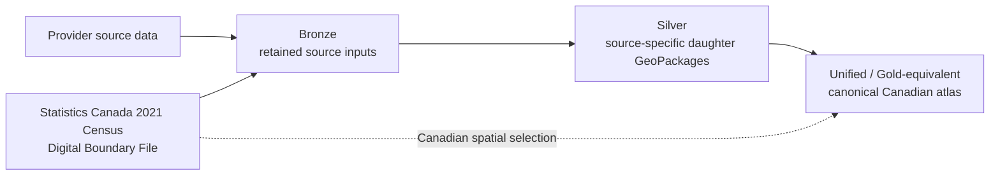

# Data Processing Methods

This document explains how CANCO2-Storage transforms provider data and why
each transformation is performed. It complements the [workflow](workflow.md),
which explains how to run the pipeline; the [schema contract](schema.md), which
defines the outputs; and the [dataset guides](datasets/), which describe the
contents and interpretation of each source package.

The methods are documented from the executable implementation in `src/`.
Exploratory notebooks may record earlier analysis, but the Python modules and
the validation applied to their persisted outputs define the current method.

## Methodological overview

The complete build first runs the registered Bronze and Silver workflows and
then the unified build. This sequence is implemented by
[`build_all.main()`](../src/canco2_storage/orchestration/build_all.py#L29-L38).
The acquisition registry contains the four geological sources and the census
boundary input
([`ACQUISITION_MODULES`](../src/canco2_storage/orchestration/bronze.py#L17-L25)),
whereas the Silver registry contains only the four geological daughter packages
([`SILVER_WORKFLOWS`](../src/canco2_storage/orchestration/silver.py#L20-L37)).
The combined precursor orchestration preserves that distinction when selecting
Bronze and Silver work
([`build_geopackages()`](../src/canco2_storage/orchestration/geopackages.py#L119-L161)).

### Processing-layer terminology

| Layer | Meaning in this repository | Methodological purpose |
| --- | --- | --- |
| Bronze | Retained provider files under `data/raw/` | Preserve the supplied evidence and validate that expected source products are present before interpretation |
| Silver | Four source-specific daughter GeoPackages under `data/processed/<dataset_id>/` | Normalize each source while retaining its own scientific or regulatory meaning, fields, representations, metadata, and QA |
| Unified / Gold-equivalent | The canonical atlas under `data/processed/unified_storage/` | Integrate selected Silver records into a common query surface without treating unlike evidence as interchangeable |

“Gold-equivalent” describes the unified layer's role in a conventional
Bronze–Silver–Gold model. The implemented commands, modules, and directories use
the term **unified**; there is no separate `data/processed/gold/` product.

## Governing principles

### Preserve source meaning before integration

Each source is harmonized independently before national integration. The
orchestrator runs the modules registered for one Silver daughter as a complete
workflow before advancing to the next
([`run_silver_dataset()`](../src/canco2_storage/orchestration/silver.py#L81-L92)).
Source-specific transformations therefore remain reviewable separately from
the unified mappings.

The workflow does not reinterpret regulatory tenure as geology, qualitative
prospectivity as storage mass, or a source-reported screening estimate as
demonstrated injectivity. The unified implementation enforces this separation
through distinct canonical storage and administrative schemas
([`CANONICAL_SCHEMAS`](../src/canco2_storage/harmonize/unified_atlas.py#L113-L184)).

### Keep logical identity, geometry, and assessment grain separate

A geological storage unit, its mapped geometry, and an assessment of that unit
are not assumed to be the same observation. The unified atlas therefore uses
separate `storage_units`, `storage_features`, and `storage_assessments` tables.
Regulatory features are stored separately in `administrative_features`.

Assessment grain is explicit: NATCARB and Atlantic assessments are assigned to
features, while BC assessments are assigned to logical units
([feature and unit scope assignments](../src/canco2_storage/harmonize/unified_atlas.py#L1472-L1588)).
The relationship checks reject orphaned unit and feature links
([`validate_canonical_tables()`](../src/canco2_storage/harmonize/unified_atlas.py#L1669-L1770)).

### Standardize spatial operations without altering scientific meaning

Silver spatial outputs use NAD83 / Canada Atlas Lambert (`EPSG:3978`), defined
once in the shared harmonization utilities
([`SILVER_CRS`](../src/canco2_storage/harmonize/common.py#L32)). Geometry repair,
projection, measurement, and CRS validation are shared technical operations
([`repair_geometries()`](../src/canco2_storage/harmonize/common.py#L73-L134) and
[`project_and_measure()`](../src/canco2_storage/harmonize/common.py#L161-L209)).
They make geometries interoperable; they do not create geological evidence or
replace source-reported attributes.

### Validate the persisted artifact

Validation is not limited to in-memory data. Silver workflows reopen written
spatial layers and check identifiers, feature counts, CRS, and geometry after
GeoPackage serialization
([`validate_written_spatial_layer()`](../src/canco2_storage/harmonize/common.py#L212-L298)).
The unified workflow likewise exports its canonical tables and then validates
the resulting GeoPackage
([`export_unified_tables()`](../src/canco2_storage/harmonize/unified_atlas.py#L2050-L2138)
and [`validate_existing_gpkg()`](../src/canco2_storage/harmonize/unified_atlas.py#L2141-L2257)).

### Preserve traceability and explicit absence

Canonical records retain source dataset, source layer, and source-derived
identifiers. Missing source values remain null rather than being converted to
zero or inferred from another dataset. Metadata, QA, source inventories, and
field dictionaries are persisted or emitted alongside the data so that a
transformation can be traced back to its daughter package and provider source.

## Structure of the remaining methods

The following sections will document Bronze acquisition, common Silver
operations, each source-specific Silver transformation, unified integration,
and final QA. Each section will use the same compact pattern:

1. inputs and source grain;
2. transformations;
3. rationale;
4. deliberate non-transformations;
5. validation and QA; and
6. resulting tables and relationships.

Detailed field inventories remain in the schema contract and dataset guides.
This document focuses on how and why records move between processing layers.
